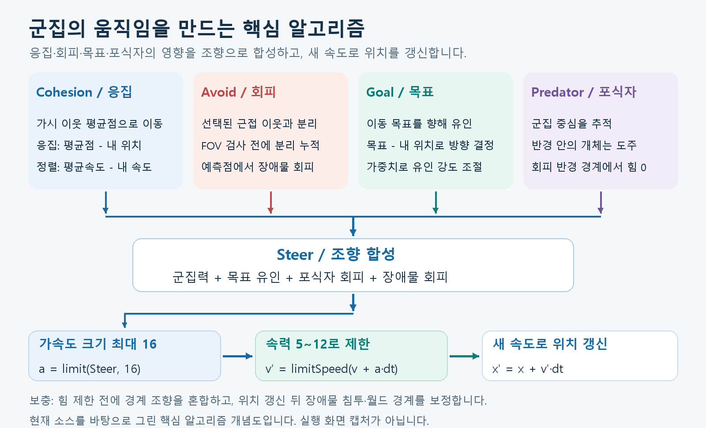

# Murmuration — Boids Lab

분리·정렬·응집 규칙으로 3차원 군집 운동을 구현한 시뮬레이션입니다.
**C++20 / WebAssembly / Three.js / Electron**을 사용합니다.


## 주요 기능

- 최대 10,000개 개체, 직접 개체 수 입력, 군집 가중치·인지 반경·시야각 조절, Grid / KD-tree 탐색 전환
- 목표 추적·포식자 회피·구와 박스 장애물 편집·실행 중 축별 월드 크기(20~500)와 경계 설정
- 개체별 이웃·조향 벡터 관찰, 일시정지·한 스텝 진행·시드 기반 재현

## 실행

**바로 실행:** 저장소를 ZIP으로 내려받아 폴더 전체를 압축 해제한 뒤 `index.html`을
Chrome 또는 Edge로 엽니다. WebGL 2가 필요하며 `dist/` 등 상대 경로를 유지해야 합니다.
Node.js나 C++ 도구 설치는 필요하지 않습니다.

**개발 서버:** Node.js 22.20.0 기준으로 프로젝트 루트에서 실행합니다.

```powershell
npm.cmd ci --ignore-scripts
npm.cmd run build
npm.cmd start
```

브라우저에서 **http://127.0.0.1:4173**에 접속합니다. macOS/Linux에서는 `npm.cmd` 대신 `npm`을 사용합니다.

## 핵심 알고리즘



아래는 현재 C++ 구현의 핵심 계산입니다. $`\mathbf{x}_i,\mathbf{v}_i`$는 위치·속도,
$`w`$는 UI 가중치입니다. 이웃을 반경·최대 개수(K)로 선택한 뒤,
**분리는 시야 검사 전**, 응집·정렬은 **시야 안 이웃**에 적용합니다.

### Cohesion — 이웃의 중심으로 모입니다

가시 이웃의 평균 위치 $`\overline{\mathbf{x}}`$로 응집하고, 평균 속도 $`\overline{\mathbf{v}}`$로 정렬합니다.
가시 이웃이 없으면 두 힘은 0입니다.

```math
\mathbf{f}_c=0.6w_c(\overline{\mathbf{x}}-\mathbf{x}_i),
\qquad \mathbf{f}_a=w_a(\overline{\mathbf{v}}-\mathbf{v}_i)
```

소스: [CalculateFlockingForces](native/src/simulation/BirdFlock.cpp).

### Avoid — 가까운 개체와 장애물을 피합니다

분리 반경 3.2 안의 선택된 이웃을 밀어냅니다. 장애물은 앞쪽 $`\mathbf{x}_i+0.45\mathbf{v}_i`$에서
표면 거리 $`d_o`$와 바깥 법선 $`\mathbf{n}`$을 구해 회피합니다.

```math
\mathbf{f}_s=13w_s\sum_j\frac{\mathbf{x}_i-\mathbf{x}_j}{\|\mathbf{x}_i-\mathbf{x}_j\|^2},
\qquad
\mathbf{f}_o=55\min\left(1,\frac{4-d_o}{L}\right)\mathbf{n}\quad(d_o\lt 4)
```

구는 $`L=r+4`$, 박스는 $`L=4`$입니다. 거의 겹친 개체의 분리는 ID에 따라 ±X 방향을 사용합니다.
소스: [CollectNeighborhood · AccumulateObstacleAvoidanceForce](native/src/simulation/BirdFlock.cpp).

### Goal — 움직이는 목표로 향합니다

곡선 경로를 따라 움직이는 목표 $`\mathbf{g}`$와의 위치 차이에 비례해 유인합니다.

```math
\mathbf{f}_g=0.28w_g(\mathbf{g}-\mathbf{x}_i)
```

```cpp
InOutForce += (Position.ToDouble() - BirdPosition) * (constants::GoalAttractionScale * AttractionWeight);
```

소스: [FGoal::Update · AccumulateAttractionForce](native/src/simulation/Goal.cpp).

### Predator — 군집을 추적하고 개체는 도주합니다

포식자는 군집 전체 평균 위치를 추적합니다. 개체는 포식자 $`\mathbf{p}`$와의 거리 $`d`$가
회피 반경 $`R_p`$ 안이면 반대 방향으로 가속합니다. 포식자와 거의 겹치면 +X 대체 방향을 사용합니다.

```math
\mathbf{f}_p=65w_p\left(1-\frac{d}{R_p}\right)
\frac{\mathbf{x}_i-\mathbf{p}}{\max(d,0.1)}\quad(d\lt R_p)
```

소스: [CalculatePursuitAcceleration · AccumulateAvoidanceForce](native/src/simulation/Predator.cpp).

### Steer — 힘을 합쳐 속도와 위치를 갱신합니다

군집 힘에 활성화된 목표·포식자·장애물 힘을 더하고 경계 조향을 반영합니다.
조향 크기는 최대 16, 속력은 5~12로 제한합니다. `Force`는 가속도 역할입니다.

```cpp
const FVector3D CurrentVelocity = Velocities->GetVector(BirdIndex);
const double ForceScale = std::min(1.0, MaximumBoidForce / std::max(Epsilon, Force.Length()));
const FVector3D NextVelocity = CurrentVelocity + Force * ForceScale * DeltaTimeSeconds;
NextVelocities->SetVector(BirdIndex, NextVelocity);
EnforceBirdSpeedRange(*NextVelocities, BirdIndex);
```

모든 다음 속도를 계산한 뒤 버퍼를 교체하고 **새 속도로 위치를 적분**합니다.
이어서 장애물 침투와 월드 경계를 보정합니다.

```math
\mathbf{x}_i^{n+1}=\mathbf{x}_i^n+\mathbf{v}_i^{n+1}\Delta t,
\qquad \Delta t=\frac{1}{60}
```

위치식은 보정 전 계산입니다. 소스: [IntegrateBirdVelocity · CommitVelocitiesAndIntegratePositions](native/src/simulation/BirdFlock.cpp).
예외 처리·저장 정밀도·경계 계산은 [수식 상세](docs/boids-theory.md),
이웃 선택은 [탐색 알고리즘](docs/neighbor-search.md)에서 확인합니다.

## 개발

| 명령 | 용도 |
| --- | --- |
| `npm.cmd run build` | 기존 Wasm으로 웹 빌드 |
| `npm.cmd run build:all` | C++ 변경 후 Wasm·웹 재빌드 — Emscripten 4.0.23 필요 |
| `npm.cmd run check` | 서식·구조·Wasm 해시·Node 회귀 검사 — clang-format 필요 |
| `npm.cmd run test:native` | 네이티브 C++ 빌드·테스트 — Windows MSVC·CMake 필요 |

화면은 `src/`, C++ 코어는 `native/`에서 수정합니다.
전체 갱신 순서는 [Simulation.cpp](native/bindings/Simulation.cpp),
군집 계산은 [BirdFlock.cpp](native/src/simulation/BirdFlock.cpp)에서 확인합니다.

## 문서

- [기술 문서 목차](docs/README.md): 이론·수식·탐색 알고리즘·아키텍처
- [C++/Wasm 개발](docs/cpp-core.md) · [VS Code 설정과 디버깅](docs/vscode.md)
- [검증 방법](docs/verification.md) · [Windows EXE 배포](docs/desktop.md)
- [GitHub 업로드 안내](docs/github-upload.md)

Boids 원 개념: [Craig Reynolds](https://www.red3d.com/cwr/boids/).
외부 라이선스: [Three.js](dist/THREE-LICENSE.txt) · [Emscripten 코어](dist/CORE-LICENSES.txt).
