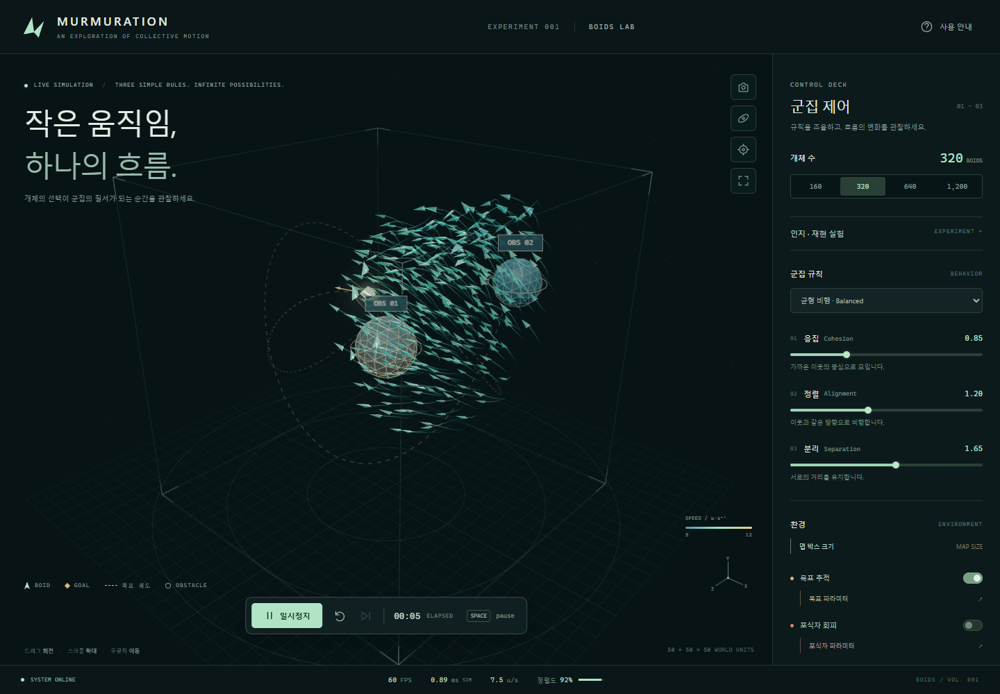
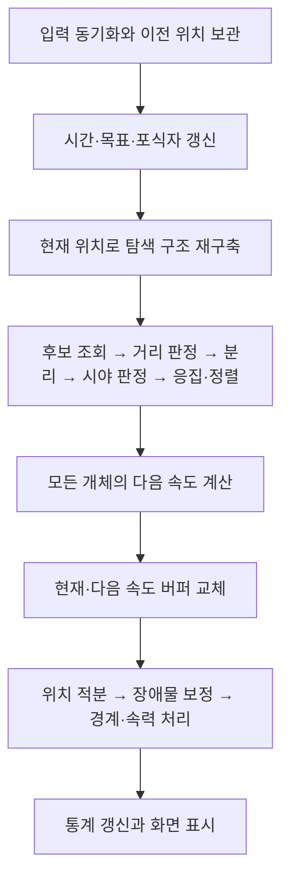

# Murmuration — Boids Lab

**분리·정렬·응집이라는 세 가지 국소 규칙으로 3차원 군집 운동을 만드는 시뮬레이션입니다.**
C++20/WebAssembly가 군집을 계산하고 Three.js/WebGL이 상태를 표시합니다.
규칙의 가중치, 인지 반경, 시야각과 이웃 탐색 방법을 바꾸며 움직임을 관찰할 수 있습니다.



[다운로드와 실행](#다운로드와-실행) · [이론과 수식](#이론과-수식) · [알고리즘](#알고리즘) · [C++ 내부 로직 읽기](#c-내부-로직-읽기) · [개발과 검증](#개발과-검증) · [GitHub 업로드 구분](docs/github-upload.md)

## 주요 기능

- 최대 1,200개 개체, 분리·정렬·응집 가중치와 시야각 조절
- Uniform Grid / KdTree 전환과 이웃 거리 검사 횟수 표시
- 움직이는 목표 추적, 포식자 회피, 구·박스 장애물 추가·이동·크기 편집
- 월드 크기 변경과 Hard / Soft / Hybrid 경계 모드
- 개체 선택 후 이웃·조향 벡터 관찰, 속력·밀도 색상, 비행 궤적
- 고정 시간 스텝, 일시정지·한 스텝 진행, 시드 기반 초기 상태 재현

## 다운로드와 실행

### 1. ZIP을 내려받아 브라우저에서 실행

1. 이 저장소의 **Code → Download ZIP**을 선택합니다. [GitHub 다운로드 안내](https://docs.github.com/en/repositories/working-with-files/using-files/downloading-source-code-archives)
2. ZIP을 **폴더 전체로 압축 해제**합니다.
3. 압축을 푼 폴더의 **`index.html`**을 Chrome 또는 Edge로 엽니다. `yoosh.html`도 같은 앱을 실행합니다.

Node.js, C++ 컴파일러, Emscripten 설치 없이 실행할 수 있습니다.
배포 번들에 Three.js와 Wasm이 포함되어 실행 중 CDN을 요청하지 않습니다.
브라우저와 그래픽 환경은 WebGL 2를 지원해야 합니다.

HTML과 아래 파일의 상대 경로를 유지합니다. HTML 파일만 다른 폴더로 옮기면 실행되지 않습니다.

```text
압축 해제한 폴더/
├─ index.html
├─ styles.css
└─ dist/
   ├─ app.js
   ├─ THREE-LICENSE.txt
   └─ CORE-LICENSES.txt
```

로컬 파일 열기가 제한된 환경이거나 화면 코드를 수정하려면 다음 개발 서버 방식을 사용합니다.

### 2. Node.js로 빌드하고 로컬 서버 실행

프로젝트의 CI 기준 버전은 **Node.js 22.20.0**입니다.
압축을 푼 폴더에서 `package.json`이 있는 위치에 터미널을 열고 실행합니다.

```powershell
npm.cmd ci --ignore-scripts
npm.cmd run build
npm.cmd start
```

브라우저에서 **http://127.0.0.1:4173**을 엽니다. 서버 종료는 터미널에서 `Ctrl+C`입니다.
macOS/Linux에서는 `npm.cmd`를 `npm`으로 바꿉니다.
처음 의존성을 설치할 때는 인터넷 연결이 필요합니다.

`build`는 저장소에 포함된 Wasm을 사용합니다. C++ 소스를 변경하지 않았다면 SDK가 필요하지 않습니다.
원본과 Wasm의 해시 불일치가 나오면 [코어 빌드 안내](docs/cpp-core.md)에 따라
Emscripten 4.0.23을 설정한 뒤 `npm.cmd run build:all`을 실행합니다.

### 3. Windows 실행파일 사용

**Releases에 Windows 배포 파일이 등록된 경우**, Assets에서
`Murmuration-Boids-Lab-<버전>-win-x64.exe`를 내려받아 실행합니다.
설치 과정 없이 동작하는 Windows x64 포터블 앱이며 Node.js나 별도 브라우저 설치가 필요하지 않습니다.
Releases의 자동 생성 `Source code (zip)`은 소스 압축본입니다.
EXE가 없는 경우에는 위 브라우저 실행 방식을 사용합니다.

현재 패키징 파일명은 `Murmuration-Boids-Lab-1.0.2-win-x64.exe`입니다.
EXE와 무결성 확인용 `.sha256`는 Releases 첨부 대상으로 관리합니다.
자세한 패키징 방법은 [Windows 배포 문서](docs/desktop.md)에 있습니다.

### 기본 조작

| 조작                               | 동작                                     |
| ---------------------------------- | ---------------------------------------- |
| 드래그 / 마우스 휠 / 우클릭 드래그 | 카메라 회전 / 확대·축소 / 이동           |
| `Space` / `R` / `C`                | 재생·정지 / 다시 시작 / 카메라 초기화    |
| 일시정지 후 한 스텝 버튼 또는 `.`  | 시뮬레이션을 1/60초 진행                 |
| 개체 관찰 버튼 → 개체 클릭         | 이웃과 분리·정렬·응집 벡터 확인          |
| 오른쪽 군집 제어 패널              | 가중치·시야각·탐색 방법·장애물·경계 설정 |

## 이론과 수식

### Boids의 세 가지 규칙

각 개체는 가까운 이웃의 위치와 속도를 읽고 자신의 조향을 결정합니다.
이 국소 상호작용으로 군집 운동이 나타나는 개념은
[Craig Reynolds의 Boids 모델](https://www.red3d.com/cwr/boids/)을 바탕으로 합니다.
아래 계수와 예외 처리는 **이 저장소의 구현**을 설명합니다.

| 규칙             | 직관                               | 계산 대상                                 |
| ---------------- | ---------------------------------- | ----------------------------------------- |
| 분리, Separation | 너무 가까운 이웃에게서 멀어집니다. | 인지 반경과 분리 반경 안의 모든 방향 이웃 |
| 정렬, Alignment  | 이웃의 속도에 맞춥니다.            | 인지 반경과 시야각을 통과한 이웃          |
| 응집, Cohesion   | 이웃의 평균 위치로 향합니다.       | 정렬과 같은 가시 이웃                     |

개체 $i$의 위치·속도를 $\mathbf{x}_i,\mathbf{v}_i$, 인지 반경을 $R$,
분리 반경을 $r_s$라고 둡니다. 분리 대상 집합은 다음과 같습니다.

$$
\mathcal{S}_i=\{j\ne i\mid \|\mathbf{x}_j-\mathbf{x}_i\|<\min(R,r_s)\}
$$

가시 이웃 집합 $\mathcal{V}_i$는 자신을 제외한 인지 반경 안의 개체 중 시야각을 통과한 집합입니다.
분리는 시야각을 적용하기 전에 계산하므로 뒤쪽의 가까운 개체도 밀어냅니다.
인지 반경 경계의 개체는 제외하며, 정지에 가깝거나 거의 겹쳐 방향을 정의하기 어려운 경우에는 시야각 판정을 생략합니다.

### 분리·정렬·응집 벡터

분리는 이웃에서 자신으로 향하는 벡터를 거리 제곱으로 나누어 합합니다.
다음 식은 겹침 예외를 제외한 경우입니다.

$$
\mathbf{f}_{s,i}=13w_s\sum_{j\in\mathcal{S}_i}
\frac{\mathbf{x}_i-\mathbf{x}_j}{\|\mathbf{x}_i-\mathbf{x}_j\|^2}
$$

벡터의 크기는 거리의 역수에 비례합니다. 거리 제곱이 $10^{-8}$보다 작으면
개체 ID 순서에 따라 반대 X축 방향을 사용하여 0으로 나누지 않습니다.

$m=|\mathcal{V}_i|>0$일 때 정렬과 응집은 다음과 같습니다.

$$
\mathbf{f}_{a,i}=w_a\left(\frac{1}{m}\sum_{j\in\mathcal{V}_i}\mathbf{v}_j-\mathbf{v}_i\right)
$$

$$
\mathbf{f}_{c,i}=0.6w_c\left(\frac{1}{m}\sum_{j\in\mathcal{V}_i}\mathbf{x}_j-\mathbf{x}_i\right)
$$

가시 이웃이 없으면 두 벡터는 0입니다. 군집 조향은
$(\mathbf{f}_{s,i}+\mathbf{f}_{c,i})+\mathbf{f}_{a,i}$ 순서로 합산합니다.
코드의 `Force`는 질량으로 나누지 않고 속도에 적용하므로 가속도 역할을 합니다.

| 매개변수                                  | 기본값            |
| ----------------------------------------- | ----------------- |
| 개체 수 / 인지 반경 $R$ / 분리 반경 $r_s$ | 320 / 10 / 3.2    |
| 분리 $w_s$ / 정렬 $w_a$ / 응집 $w_c$      | 1.65 / 1.2 / 0.85 |
| 전체 시야각 / 고정 시간 간격              | 360° / 1/60초     |
| 속력 제한 / 최종 조향 크기 제한           | 5~12 / 16         |

근거: [BirdFlock.cpp](native/src/simulation/BirdFlock.cpp),
[SimulationConstants.h](native/src/core/SimulationConstants.h), [config.js](src/config.js).

### 속도와 위치 갱신

군집 조향에 목표·포식자·장애물 조향을 더하고 경계 모드의 처리를 적용한 결과를 $\mathbf{f}_i$라 둡니다.
최종 조향의 크기를 16으로 제한한 뒤 속도를 먼저 갱신합니다.

$$
\widehat{\mathbf{f}}_i=\mathbf{f}_i\min\left(1,\frac{16}{\max(10^{-8},\|\mathbf{f}_i\|)}\right)
$$

$$
\mathbf{v}_i^{\mathrm{next}}=\operatorname{limitSpeed}_{[5,12]}
\left(\mathbf{v}_i+\widehat{\mathbf{f}}_i\Delta t\right),
\qquad
\mathbf{x}_i^{\mathrm{trial}}=\mathbf{x}_i+\mathbf{v}_i^{\mathrm{next}}\Delta t
$$

새 속도로 위치를 갱신하는 **semi-implicit Euler** 순서입니다.
`limitSpeed`는 방향을 유지하며 속력을 제한하고, 속력이 $10^{-8}$보다 작으면 $(5,0,0)$을 사용합니다.
위 식은 float32 저장 반올림을 생략한 표현이며, 실제 저장 시점과 예외 처리는 [상세 수식](docs/boids-theory.md)에 정리했습니다.
위치 적분 뒤에는 장애물 침투 보정, 월드 경계 처리, 속력 제한을 적용합니다.

| 경계 모드 | 적분 전                | 적분 후                                                   |
| --------- | ---------------------- | --------------------------------------------------------- |
| Hard      | 경계 조향 없음         | 경계 밖 좌표를 면에 고정하고 해당 축 속도를 안쪽으로 변경 |
| Soft      | 안쪽으로 유도하는 조향 | 월드 위치 고정 없이 일시적인 이탈 허용                    |
| Hybrid    | Soft와 같은 조향       | Hard와 같은 사후 경계 처리                                |

### 세 개체로 보는 계산 예

설명용으로 가중치를 모두 1, 시야각을 360°, 인지 반경을 10으로 둡니다.
자신의 위치·속도는 $(0,0,0)$·$(6,0,0)$, 두 이웃은 각각
$(2,0,0)$·$(6,2,0)$, $(0,4,0)$·$(5,0,0)$입니다.
목표·포식자·장애물은 끄고 Hard 경계 내부에서 계산합니다.

| 계산                                 | 결과                       |
| ------------------------------------ | -------------------------- |
| 분리: 첫 이웃만 반경 3.2 안에 있음   | $(-6.5,0,0)$               |
| 응집: 평균 위치 $(1,2,0)$로 향함     | $(0.6,1.2,0)$              |
| 정렬: 평균 속도 $(5.5,1,0)$와의 차이 | $(-0.5,1,0)$               |
| 합성 조향                            | $(-6.4,2.2,0)$             |
| 1/60초 뒤 속도                       | 약 $(5.893333,0.036667,0)$ |
| 1/60초 뒤 위치                       | 약 $(0.098222,0.000611,0)$ |

## 알고리즘

### 알고리즘 1: Boids 전체 갱신

현재 C++ 구현의 처리 순서를 나타낸 의사코드입니다. `x`, `v`는 현재 위치·속도,
`nextV`는 다음 속도 버퍼입니다. `Separation`, `Cohesion`, `Alignment`는 앞의 수식처럼
각 규칙의 가중치와 내부 배율까지 적용한 조향 벡터를 반환합니다.

```text
InitializeStates(seed)
while 고정 시간 스텝 Δt를 진행할 때 do
    SynchronizeInputs()
    SavePreviousPositions()
    AdvanceTime(Δt)
    UpdateGoalAndPredator(Δt)
    RebuildNeighborSearch(x)

    for each boid i do
        (S_i, V_i) ← FindNeighbors(i, x, v)
        f_s ← Separation(i, S_i)
        f_c ← Cohesion(i, V_i)
        f_a ← Alignment(i, V_i)
        f ← (f_s + f_c) + f_a
        f ← AddGoalPredatorAndObstacleSteering(i, f)
        f ← BlendBoundarySteering(i, f)
        nextV[i] ← LimitSpeed(v[i] + LimitMagnitude(f, 16) * Δt, 5, 12)
    end

    swap(v, nextV)
    for each boid i do
        x[i] ← x[i] + v[i] * Δt
        ResolveObstaclesIfEnabled(i)
        EnforceBoundsAndSpeed(i)
    end
    PublishMetricsAndState()
end
```

`FindNeighbors`는 탐색 후보에 정확한 거리·시야각 판정을 적용하여 분리 대상 $\mathcal{S}_i$와
가시 이웃 $\mathcal{V}_i$를 구하는 단계를 뜻합니다. 실제 코드는 집합을 따로 저장하지 않고
`CollectNeighborhood`에서 분리 벡터·위치·속도 합을 바로 누적합니다.
모든 `nextV`를 계산할 때까지 `x`, `v`를 유지하고, 버퍼 교체 후 새 속도로 위치를 적분합니다.
의사코드는 float32 저장 반올림과 진단용 거리 검사 횟수의 누적을 생략했습니다.

구현: [FSimulation::Step](native/bindings/Simulation.cpp),
[FBirdFlock::IntegrateNextVelocities / CommitVelocitiesAndIntegratePositions](native/src/simulation/BirdFlock.cpp).

### 알고리즘 2: 분리 조향 계산

분리 대상 $\mathcal{S}_i$는 인지 반경과 분리 반경 안의 이웃이며 시야각으로 제외하지 않습니다.
`DistanceSquared`는 거리의 제곱이며, 겹침 판정에 사용하는 `Epsilon`은 $10^{-8}$입니다.

```text
Separation(i, S_i):
    SeparationSum ← (0, 0, 0)
    for each neighbor j in S_i do
        AwayFromNeighbor ← x[i] - x[j]
        DistanceSquared ← dot(AwayFromNeighbor, AwayFromNeighbor)
        if DistanceSquared < Epsilon then
            if i < j then
                SeparationSum.x ← SeparationSum.x - 1
            else
                SeparationSum.x ← SeparationSum.x + 1
            end
        else
            SeparationSum ← SeparationSum + AwayFromNeighbor / DistanceSquared
        end
    end
    return 13 * w_s * SeparationSum
```

`AwayFromNeighbor`의 길이가 이미 거리 $r$이므로, 거리 제곱으로 나눈 기여분의 크기는 $1/r$입니다.
따라서 가까운 이웃일수록 강하게 밀어냅니다. 거의 겹친 이웃은 인덱스 순서에 따라 서로 반대인
X축 방향을 사용합니다. 분리 조향만으로 모든 개체 사이의 비침투를 보장하지는 않습니다.
구현: [FBirdFlock::CollectNeighborhood / CalculateFlockingForces](native/src/simulation/BirdFlock.cpp).

### 한 스텝의 처리 순서



모든 개체는 같은 시점의 위치·속도를 읽고 다음 속도 버퍼에 기록합니다.
전부 계산한 뒤 버퍼를 교체하므로 앞서 처리한 개체의 새 속도를 뒤쪽 개체가 읽는 문제를 피합니다.
앱은 $\Delta t=1/60$초로 계산하며 렌더러는 이전·현재 위치를 보간하여 표시합니다.
전체 순서는 [FSimulation::Step](native/bindings/Simulation.cpp),
시간 누적은 [SimulationClock](src/simulation/clock.js)에서 확인할 수 있습니다.

### 이웃 탐색 방법 비교

세 방법은 **후보를 찾는 과정**만 다릅니다. 정확한 거리·시야각 판정과 군집 수식은 공통 코드를 사용합니다.
UI에서는 Grid와 KdTree를 선택하며, AllPairs는 테스트·벤치마크 기준입니다.

| 방법         | 처리 방식                                                   | 비용과 특성                                       |
| ------------ | ----------------------------------------------------------- | ------------------------------------------------- |
| AllPairs     | 모든 개체 쌍의 거리 검사                                    | 한 스텝에 $N(N-1)$회, $O(N^2)$                    |
| Uniform Grid | 셀에 개체를 등록하고 인접 셀 중 반경과 겹치는 셀 조회       | 재구축 $O(C+N)$, 한 조회와 후보 처리 $O(B_i+Q_i)$ |
| KdTree       | X/Y/Z축 중앙값으로 분할하고 조회 구가 닿지 않는 반공간 생략 | 한 조회 $O(V_i)$, 최악 $O(N)$; 재구축 비용 별도   |

$C$는 활성 셀 수, $B_i$는 조회 셀 범위의 크기, $Q_i$는 후보 수, $V_i$는 방문 노드 수입니다.
KdTree는 중앙값 선택이 구간마다 선형 비용으로 끝나면 $O(N\log N)$에 재구축됩니다.
현재 선택 알고리즘은 최악 선형 시간을 보장하지 않아 구축도 최악 $O(N^2)$까지 커질 수 있습니다.
두 공간 자료구조 모두 밀집된 분포나 큰 반경에서는 전체 조회 비용이 $O(N^2)$까지 증가합니다.

Grid는 셀까지의 거리 하한으로 가지치기하고, KdTree는 분할면과 조회 반경으로 방문할 자식을 결정합니다.
정확한 이웃을 누락하지 않는 조건, Soft 경계 밖 처리와 구현은 [이웃 탐색 문서](docs/neighbor-search.md)에 있습니다.
탐색 방식에 따라 합산 순서가 달라질 수 있으므로 부동소수점 궤적의 비트 단위 일치까지 보장하지는 않습니다.

## 구조와 개발

```text
native/src/                 C++ 군집·공간 탐색·충돌·상태
native/bindings/            C ABI 변환과 시뮬레이션 조율
native/bindings/include/boids/       공개 C API
src/simulation/            Wasm 연결과 입력 검증
src/rendering/             Three.js 렌더러와 시각화
src/ui/                    화면 입력과 표시
tests/                     Node·C++·브라우저·EXE 검사
tools/                     빌드·서버·검증 도구
docs/                      이론·수식·알고리즘·설계 문서
```

C++이 시뮬레이션 저장소를 소유하고 JS는 TypedArray로 상태를 읽습니다.
Wasm은 고정 2 MiB 메모리와 ABI v1을 사용합니다.
렌더러는 GPU 자원과 화면 표시를, UI는 사용자 입력을 담당합니다.
소유권·수명·실패 처리는 [아키텍처 문서](docs/architecture.md)에 정리했습니다.

## C++ 내부 로직 읽기

**전체 갱신 순서는 `native/bindings/Simulation.cpp`의 `FSimulation::Step`,
실제 군집 계산은 `native/src/simulation/BirdFlock.cpp`부터 확인합니다.**
각 `.h`에는 함수 계약·입출력·버퍼 소유권이, `.cpp`에는 계산식과 분기·반복문이 있습니다.

### 처음 읽을 때의 순서

| 순서 | 소스코드 | 확인할 내용 |
| --- | --- | --- |
| 1 | [Simulation.h](native/bindings/Simulation.h) / [Simulation.cpp](native/bindings/Simulation.cpp) | `Reset`으로 초기 상태를 만들고, `Step`에서 입력 동기화 → 목표·포식자 갱신 → 이웃 탐색 → 군집 이동 → 통계 발행 순서를 확인합니다. |
| 2 | [BirdFlock.h](native/src/simulation/BirdFlock.h) / [BirdVectorBuffer.h](native/src/simulation/BirdVectorBuffer.h) | `FFlockContext`로 빌리는 설정·객체와 군집이 소유하는 위치·속도 저장소를 구분합니다. `Velocities`, `NextVelocities`는 두 소유 버퍼의 역할을 가리키는 포인터입니다. |
| 3 | [BirdFlock.cpp](native/src/simulation/BirdFlock.cpp)의 `IntegrateNextVelocities` | 각 개체의 군집 조향과 외부 조향을 합성한 뒤 `IntegrateBirdVelocity`로 다음 속도만 기록하는 과정을 확인합니다. |
| 4 | 같은 파일의 `EvaluateFlocking` → `CollectNeighborhood` → `CalculateFlockingForces` | 후보의 정확한 거리·시야각 판정, 분리 벡터 누적, 이웃 평균을 이용한 응집·정렬, 규칙별 가중치 적용을 확인합니다. 분리는 시야각 판정보다 먼저 누적합니다. |
| 5 | 같은 파일의 `CommitVelocitiesAndIntegratePositions` | 전체 다음 속도 계산 후 버퍼 역할을 교체하고, 새 속도로 위치를 적분한 뒤 장애물·경계·속력을 보정하는 순서를 확인합니다. |

### 관심 주제별 소스코드

| 주제 | 소스코드 | 확인할 내용 |
| --- | --- | --- |
| 이웃 탐색 방식 선택 | [NeighborSearch.h](native/src/simulation/NeighborSearch.h) / [NeighborSearch.cpp](native/src/simulation/NeighborSearch.cpp) | `Rebuild`, `QueryCandidates`에서 AllPairs·Grid·KdTree를 선택합니다. 반환값은 후보 목록이며 최종 거리·시야각 판정은 `BirdFlock.cpp`에서 수행합니다. |
| Uniform Grid | [SpatialGrid.h](native/src/simulation/SpatialGrid.h) / [SpatialGrid.cpp](native/src/simulation/SpatialGrid.cpp) | `Rebuild`의 셀 등록, `QueryCandidates`의 조회 셀 범위와 셀까지의 거리 하한을 이용한 가지치기를 확인합니다. |
| KD-tree | [KdTree.h](native/src/simulation/KdTree.h) / [KdTree.cpp](native/src/simulation/KdTree.cpp) | 구축은 `Rebuild` → `BuildBranch` → `SelectMedian` → `PartitionIndices` 순서로 읽습니다. 조회는 `QueryCandidates`에서 분할면과 조회 반경으로 방문할 가지를 결정합니다. |
| 목표·포식자와 외부 조향 | [Goal.cpp](native/src/simulation/Goal.cpp), [Predator.cpp](native/src/simulation/Predator.cpp), [BirdFlock.cpp](native/src/simulation/BirdFlock.cpp) | 목표 경로·포식자 추적을 먼저 확인하고, `AccumulateExternalForces`에서 목표 인력·포식자 회피·장애물 회피와 경계 조향을 연결합니다. |
| 장애물 거리·법선과 충돌 응답 | [Obstacle.h](native/src/collision/Obstacle.h), [SphereObstacle.cpp](native/src/collision/SphereObstacle.cpp), [BoxObstacle.cpp](native/src/collision/BoxObstacle.cpp), [ObstacleSet.cpp](native/src/collision/ObstacleSet.cpp) | 형상별 `CalculateSignedDistance`와 장애물 객체 구성을 확인합니다. 실제 개체의 침투 보정·속도 반사는 `BirdFlock.cpp`의 `ResolveObstacles`에서 처리합니다. |
| 위치 갱신의 멀티스레딩 | [BirdUpdateExecutor.h](native/src/simulation/BirdUpdateExecutor.h) / [BirdUpdateExecutor.cpp](native/src/simulation/BirdUpdateExecutor.cpp) | `ForEachRange`, `Execute`, `WorkerLoop`에서 개체 구간 분할, 작업 배포·완료 대기, 워커 종료를 확인합니다. 네이티브는 조건에 따라 `std::thread`를 사용하고 Wasm은 직렬 실행합니다. |
| 설정·상수·시간 상태 | [SimulationConfig.h](native/src/core/SimulationConfig.h), [SimulationConstants.h](native/src/core/SimulationConstants.h), [SimulationState.cpp](native/src/simulation/SimulationState.cpp) | 규칙 가중치·반경·경계 모드, 내부 배율·수치 임계값, 시간·목표 위상·통계 기록을 확인합니다. |
| C API와 ABI 입출력 | [boids.h](native/bindings/include/boids/boids.h), [Bindings.cpp](native/bindings/Bindings.cpp), [SimulationAbi.cpp](native/bindings/SimulationAbi.cpp) | 공개 `boids_step`이 `FSimulation::Step`으로 연결되는 경로와 ABI 배열을 내부 스냅샷으로 읽고 결과를 발행하는 과정을 확인합니다. |

동작을 따라가려면 `FSimulation::Step`, `FBirdFlock::CollectNeighborhood`,
`FBirdFlock::IntegrateBirdVelocity`, `FBirdFlock::CommitVelocitiesAndIntegratePositions`에
중단점을 두고 한 스텝을 진행합니다. [VS Code 디버깅 안내](docs/vscode.md)와
[네이티브 실행 진입점](tests/native/DebugRunner.cpp)을 함께 확인할 수 있습니다.
리뷰 질문과 보존해야 할 계약은 [코드 리뷰 가이드](docs/code-review-guide.md)에 정리했습니다.

## 개발과 검증

| 명령                        | 용도와 필요한 환경                               |
| --------------------------- | ------------------------------------------------ |
| `npm.cmd test`              | Node 내장 테스트 러너로 단위·수치 회귀 검사      |
| `npm.cmd run check:runtime` | 현재 C++ 원본과 내장 Wasm의 해시 확인            |
| `npm.cmd run check`         | 서식·구조·Wasm 연결·Node 검사; clang-format 필요 |
| `npm.cmd run test:browser`  | Playwright 화면·입력 검사; 설치된 Chrome 필요    |
| `npm.cmd run test:native`   | Windows MSVC·CMake로 C++ 빌드와 CTest            |
| `npm.cmd run build:all`     | Emscripten 4.0.23으로 코어와 웹 번들 재생성      |
| `npm.cmd run benchmark`     | 동일 조건에서 탐색 방법별 CPU 비용 비교          |
| `npm.cmd run dev:setup`     | Windows VS Code의 C++ 빌드·디버깅 환경 설정      |

전체 Wasm·네이티브·브라우저 검사는 `npm.cmd run verify`로 실행합니다.

기능 검사의 통과와 성능 개선은 별도 근거로 판단합니다.
측정 조건과 지표는 [성능 문서](docs/performance.md), 실행 검사는 [검증 방법](docs/verification.md)에 있습니다.
이 모델은 군집 행동을 표현하며 실제 새의 비행 역학이나 모든 개체 사이의 충돌 방지를 보장하지 않습니다.

## GitHub에 포함하는 파일

소스·테스트·문서·공용 설정과 **다운로드 즉시 실행에 필요한 `dist/`, `src/simulation/generated/`, `yoosh.html`**을 포함합니다.

| 구분 | 대상 |
| --- | --- |
| 저장소 | `native/`, `src/`, `tests/`, `tools/`, `desktop/`, 문서·이미지, lockfile·공용 설정, 위 실행 산출물과 라이선스 고지 |
| 로컬 보관 | `node_modules/`, SDK, `build/`, `artifacts/`, 개인 설정·`.env`, 원본 과제 PDF, 과거 전체 작업 사본 |
| Releases | 검증한 Windows EXE와 같은 버전의 SHA-256 체크섬 |

제외한 원본은 삭제하지 않습니다. `*.wasm`·`dist/`를 일반 템플릿으로 제외하면 실행 구성이 누락됩니다.
파일별 구분과 업로드 순서는 [GitHub 업로드 안내](docs/github-upload.md)를 확인합니다.
공개 대상 파일만으로 구성한 새 복사본에서 설치·빌드·검사를 확인합니다.

## 더 읽기

- [Boids 이론과 상세 수식](docs/boids-theory.md): 시야각, 겹침 처리, 외부 조향과 적분
- [이웃 탐색 알고리즘](docs/neighbor-search.md): Grid·KdTree 구현, 누락 방지 조건과 복잡도
- [C++/Wasm 개발](docs/cpp-core.md) · [VS Code 디버깅](docs/vscode.md) · [Windows 배포](docs/desktop.md)
- [C++ 코딩 표준](docs/cpp-coding-standard.md) · [기술 문서 목차](docs/README.md)

원 개념의 출처는 [Craig Reynolds, Boids](https://www.red3d.com/cwr/boids/)입니다.
외부 런타임의 라이선스 고지는 [Three.js](dist/THREE-LICENSE.txt)와
[Emscripten 코어](dist/CORE-LICENSES.txt)에 포함되어 있습니다.


## Windows EXE 배포

`npm.cmd run release:exe`로 검사·오프라인 EXE 패키징·실행 검증을 수행합니다.
배포 파일은 `release/`에 생성합니다. [공통 배포 절차](docs/desktop.md)를 따릅니다.


## 공통 폴더·빌드 구조

현재 경로와 명령은 [공통 폴더·빌드 구조](docs/project-layout.md)를 따릅니다.
웹 원본은 src/, 웹 산출물은 dist/, Wasm은 wasm/, CMake 산출물은 build/native/, EXE는 release/입니다.
`npm run build`는 SDK 없이 웹을 생성하며 C++ 수정 후에는 `npm run build:all`을 실행합니다.


C++ 파일의 공통 배치와 기존 경로의 이동 기준은 [native 내부 구조](docs/native-layout.md)를 따릅니다.


## C++ 코드 리뷰

[코드 리뷰 가이드](docs/code-review-guide.md)에서 핵심 함수의 읽기 순서, 보존 계약, 리뷰 질문과 관련 검사를 확인합니다.
함수 설명 주석은 짧은 Doxygen 형식을 사용합니다.
