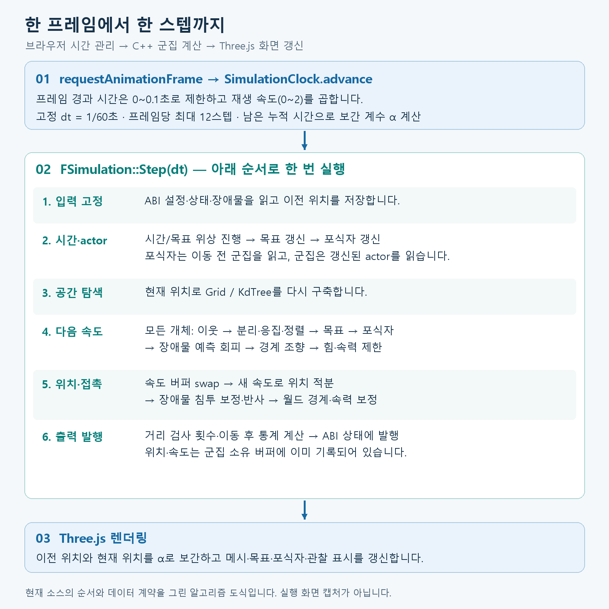
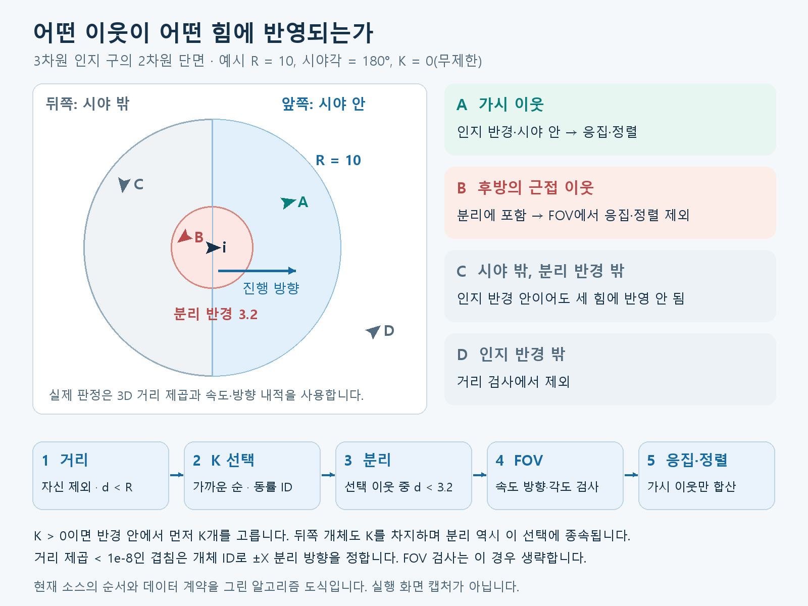
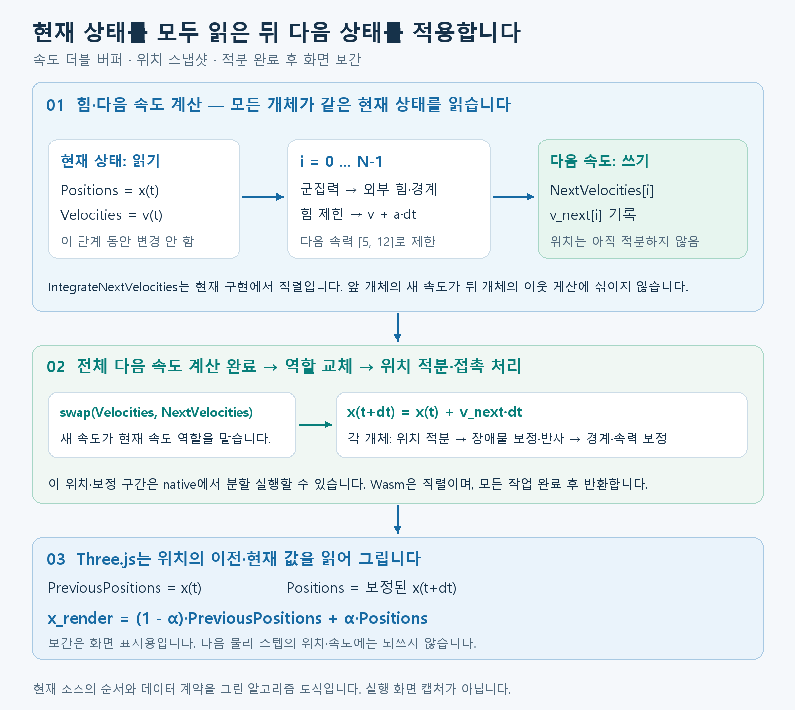

# Murmuration — Boids Lab

분리·정렬·응집 규칙으로 3차원 군집 운동을 구현한 시뮬레이션입니다.
**C++20 / WebAssembly / Three.js / Electron**을 사용합니다.


## 주요 기능

- 최대 10,000개 개체, 직접 개체 수 입력, 군집 가중치·인지 반경·시야각 조절, Grid / KD-tree 탐색 전환
- 목표 추적·포식자 회피·구와 박스 장애물 편집·실행 중 축별 월드 크기(20~500)와 경계 설정
- 개체별 이웃·조향 벡터 관찰, 일시정지·한 스텝 진행·시드 기반 재현

## 실행

**바로 실행:** 저장소를 ZIP으로 내려받아 폴더 전체를 압축 해제한 뒤 `index.html`을
Chrome 또는 Edge로 엽니다. WebGL 2가 필요하며 `dist/` 등 상대 경로를 유지해야 합니다.
Node.js나 C++ 도구 설치는 필요하지 않습니다.

**개발 서버:** Node.js 22.20.0 기준으로 프로젝트 루트에서 실행합니다.

```powershell
npm.cmd ci --ignore-scripts
npm.cmd run build
npm.cmd start
```

브라우저에서 **http://127.0.0.1:4173**에 접속합니다. macOS/Linux에서는 `npm.cmd` 대신 `npm`을 사용합니다.

## 전체 알고리즘 흐름

아래 내용은 **2026-11-08의 C++/JS 소스**를 기준으로 설명합니다. PNG는 소스의
처리 순서를 그린 도식이며, 위의 실행 화면 캡처와 구분합니다. 코드의 `Force`는
질량으로 나누지 않고 속도에 적용하므로 **가속도 역할을 하는 조향 벡터**입니다.
위치는 프로젝트의 월드 단위, 시간은 초를 사용합니다.



### 1. 초기화와 고정 시간 스텝

초기화는 Wasm 코어 → 시뮬레이션 → Three.js 화면 → UI → 실행 루프 순서입니다.
`Reset(seed)`는 Mulberry32 난수로 개체 위치·속도를 생성하고 속력을 보정합니다.
장애물이 활성화되어 있으면 초기 침투도 보정하고 이전 위치를 현재 위치에 맞춥니다.
같은 시드와 설정으로 다시 시작할 수 있으며, 탐색 방식에 따라 합산 순서는 달라질 수 있습니다.

브라우저의 `requestAnimationFrame` 간격을 물리 시간으로 그대로 사용하지 않습니다.
[SimulationClock.advance](src/simulation/clock.js)는 누적 시간을 **1/60초씩** 소비합니다.
프레임 경과 시간은 최대 0.1초, 배속은 0~2, 한 프레임의 계산은 최대 12스텝으로 제한합니다.
12스텝에 도달하면 남은 누적 시간에서 정수 스텝을 버려 지연이 계속 쌓이지 않게 합니다.

$$
A\leftarrow A+\operatorname{clamp}(\Delta t_{\mathrm{frame}},0,0.1)s,
\qquad \Delta t=\frac{1}{60},\qquad \alpha=\frac{A_{\mathrm{remaining}}}{\Delta t}
$$

실행 중에는 한 화면 프레임에서 물리 스텝이 0회 또는 여러 번 실행될 수 있습니다.
일시정지 상태의 단일 스텝은 같은 고정 시간으로 한 번 진행합니다.
실행 조율은 [application-controller.js](src/application-controller.js),
JS 입력 검증과 코어 호출은 [boids.js](src/simulation/boids.js)에 있습니다.

### 2. C++ 한 스텝의 실행 순서

[FSimulation::Step](native/bindings/Simulation.cpp)의 실제 호출 순서입니다.
아래 코드는 원본에서 주석과 빈 줄만 줄였습니다.

```cpp
void FSimulation::Step(double DeltaTime)
{
    RefreshInputsFromAbi();
    Birds.SnapInterpolation();
    State.AdvanceTime(DeltaTime, Config.bGoalEnabled, Config.GoalSpeedMultiplier);
    UpdateGoalFromCurrentState();
    UpdatePredatorFromCurrentState(DeltaTime);
    const FFlockContext Context = CreateFlockContext();
    Birds.RebuildNeighborSearch(Context);
    const double NeighborDistanceChecks = Birds.IntegrateNextVelocities(DeltaTime, Context);
    Birds.CommitVelocitiesAndIntegratePositions(DeltaTime, Context);
    State.RecordNeighborDistanceChecks(NeighborDistanceChecks);
    WriteFlockMetrics();
    Abi.PublishStepState(State);
}
```

| 단계 | 읽는 데이터와 처리 | 결과 |
| --- | --- | --- |
| 입력 스냅샷 | ABI 설정·상태·장애물을 내부 객체에 반영 | 이번 스텝에서 사용할 입력 |
| 이전 위치 저장 | 이동 전 개체 위치 복사 | 화면 보간용 `PreviousPositions` |
| 시간·행동 대상 | 목표 위상 진행, 목표 이동, 이동 전 군집 중심으로 포식자 이동 | 갱신된 목표·포식자 위치 |
| 이웃 계산 | 현재 위치로 탐색기 재구축, 현재 위치·속도로 모든 조향 계산 | `NextVelocities`, 가시 이웃 수 |
| 이동·보정 | 속도 버퍼 교체, 새 속도로 위치 적분, 장애물 → 월드 경계 → 속력 보정 | 다음 스텝의 위치·속도 |
| 발행 | 거리 검사 수와 이동 후 군집 통계 기록 | JS가 조회하는 ABI 상태 |

목표·포식자를 먼저 움직이므로 개체는 **갱신된 목표·포식자와 이동 전 이웃**을 봅니다.
위치·속도는 군집이 소유한 버퍼에 이미 기록되며, 마지막 발행에서 다시 복사하지 않습니다.

### 3. 공간 탐색과 실제 이웃 선택



개체 수를 $N$, 현재 위치·속도를 $\mathbf{x}_i,\mathbf{v}_i$, 인지 반경을 $R$,
전체 시야각을 $\theta$, 최대 이웃 수를 $K$라고 합니다.
탐색기는 **후보**를 반환하고 `CollectNeighborhood`가 실제 이웃을 선택합니다.

$$
\mathbf{d}_{ij}=\mathbf{x}_j-\mathbf{x}_i,\qquad
q_{ij}=\|\mathbf{d}_{ij}\|^2,\qquad
\mathcal{P}_i=\{j\ne i\mid q_{ij}<R^2\}
$$

$K=0$이면 $\mathcal{T}_i=\mathcal{P}_i$입니다. $K>0$이면 $\mathcal{P}_i$ 중
가까운 최대 $K$개를 $\mathcal{T}_i$로 선택합니다. 거리가 같으면 개체 ID가 작은 쪽을
우선합니다. 이 선택은 **시야각 검사 전**이며, 분리도 선택된 집합 안에서 계산합니다.
따라서 시야 밖 이웃이 선택되면 가시 이웃 수는 $K$보다 작을 수 있습니다.

분리 집합은 $\mathcal{S}_i=\{j\in\mathcal{T}_i\mid q_{ij}<3.2^2\}$입니다.
응집·정렬의 가시 집합 $\mathcal{V}_i$에는 $\mathcal{T}_i$ 중 다음 조건을 통과한 이웃을 넣습니다.

$$
\mathbf{v}_i\cdot\mathbf{d}_{ij}
\ge \cos\left(\frac{\theta\pi}{360}\right)
\sqrt{\|\mathbf{v}_i\|^2q_{ij}}-10^{-10}
$$

이 시야 조건은 $\theta<360^\circ$, $\|\mathbf{v}_i\|^2>10^{-8}$,
$q_{ij}\ge10^{-8}$일 때 적용합니다. 그 외에는 시야각으로 제외하지 않습니다.
**분리를 먼저 누적하므로 후방의 가까운 개체도 밀어냅니다.**
거리 경계 $q_{ij}=R^2$와 분리 경계 $q_{ij}=3.2^2$는 각각 제외합니다.

| 탐색 방식 | 매 스텝 구축 | 후보 조회와 비용 |
| --- | --- | --- |
| Uniform Grid | 셀 머리와 개체 연결 배열에 등록, $O(C+N)$ | 반경에 걸친 셀을 순회하고 셀까지의 거리 하한으로 제외합니다. 한 조회는 $O(B_i+Q_i)$입니다. |
| KD-tree | X/Y/Z를 번갈아 중앙값 분할 | 분할면과 반경으로 자식을 가지치기합니다. 한 조회는 방문 노드 수 $O(V_i)$, 최악 $O(N)$입니다. |
| AllPairs | 개체 ID 목록 생성, $O(N)$ | 모든 개체를 후보로 사용합니다. 전체 거리 검사는 $N(N-1)$회이며 검사·비교 기준입니다. |

$C$는 활성 셀 수, $B_i$는 가지치기 전 조회 셀 수, $Q_i$는 반환 후보 수입니다.
Grid의 축별 탐색 폭은 $\lceil R/h\rceil$이며, **항상 27셀인 것은 아닙니다.**
KD-tree 구축은 중앙값 선택이 구간당 선형에 가까우면 $O(N\log N)$이지만,
현재 선택 알고리즘은 최악 입력에서 $O(N^2)$까지 커질 수 있습니다.
두 탐색 방식 모두 밀집·큰 반경에서는 전체 이웃 처리가 $O(N^2)$가 될 수 있습니다.
$K>0$의 최대 힙 선택은 후보를 일찍 끊지 않으며, 조회당 최악
$O(Q_i\log(K+1)+K\log(K+1))$의 선택·정렬 비용이 추가됩니다.

구현은 [NeighborSearch.cpp](native/src/simulation/NeighborSearch.cpp),
[SpatialGrid.cpp](native/src/simulation/SpatialGrid.cpp),
[KdTree.cpp](native/src/simulation/KdTree.cpp),
[CollectNeighborhood](native/src/simulation/BirdFlock.cpp)에 있습니다.
셀 배치·가지치기·후보 순서의 상세 근거는 [이웃 탐색 문서](docs/neighbor-search.md)를 확인합니다.

### 4. 분리·응집·정렬의 수식과 코드

분리·응집·정렬 가중치를 $w_s,w_c,w_a$, 가시 이웃 수를 $m=|\mathcal{V}_i|$로 둡니다.
세 규칙은 다음과 같습니다. $m=0$이면 응집·정렬은 0입니다.

$$
\begin{aligned}
\mathbf{s}_i&=13w_s\sum_{j\in\mathcal{S}_i}\mathbf{b}_{ij},\\
\mathbf{c}_i&=0.6w_c\left(\frac{1}{m}\sum_{j\in\mathcal{V}_i}\mathbf{x}_j-\mathbf{x}_i\right),\\
\mathbf{a}_i&=w_a\left(\frac{1}{m}\sum_{j\in\mathcal{V}_i}\mathbf{v}_j-\mathbf{v}_i\right),\\
\mathbf{f}_{\mathrm{flock},i}&=(\mathbf{s}_i+\mathbf{c}_i)+\mathbf{a}_i.
\end{aligned}
$$

일반적인 분리 항은 다음과 같습니다.

$$
\mathbf{b}_{ij}=\frac{\mathbf{x}_i-\mathbf{x}_j}{q_{ij}}
\qquad(q_{ij}\ge\varepsilon,\quad\varepsilon=10^{-8})
$$

벡터 크기는 거리의 역수에 비례하며, 이웃 수로 평균 내지 않습니다.
$q_{ij}<\varepsilon$이면 나눗셈 대신 ID에 따라 $i<j$일 때 $(-1,0,0)$,
$i>j$일 때 $(1,0,0)$을 사용해 거의 겹친 개체를 반대 방향으로 밀어냅니다.

아래는 `CalculateFlockingForces`의 실제 계산 부분입니다.
`PositionSum`·`VelocitySum`은 가시 이웃의 합이고 `SeparationSum`은 시야 검사 전의 분리 합입니다.

```cpp
FVector3D CohesionForce = Accumulator.PositionSum;
FVector3D AlignmentForce = Accumulator.VelocitySum;
FVector3D SeparationForce = Accumulator.SeparationSum;

if (Accumulator.VisibleNeighborCount)
{
    CohesionForce = (CohesionForce / Accumulator.VisibleNeighborCount - Positions.GetVector(BirdIndex)) * (Context.Config.CohesionWeight * CohesionScale);
    AlignmentForce = (AlignmentForce / Accumulator.VisibleNeighborCount - Velocities->GetVector(BirdIndex)) * Context.Config.AlignmentWeight;
}

SeparationForce *= Context.Config.SeparationWeight * SeparationScale;
```

수식의 13과 0.6은 [SimulationConstants.h](native/src/core/SimulationConstants.h)의
`SeparationScale`, `CohesionScale`입니다. UI의 가중치와 별도로 곱해집니다.
선택 개체 관찰 UI의 세 벡터도 이 가중치 적용 결과이며, 외력·경계·최종 제한 이전 값입니다.

**작은 계산 예시:** 외력·경계 조향이 없고 $w_s=w_c=w_a=1$, $K=0$,
$R>2$, 시야각 360도라고 가정합니다. 아래 값은 설명용 입력입니다.

| 개체 | 위치 | 속도 |
| --- | --- | --- |
| 자신 $i$ | $(0,0,0)$ | $(6,0,0)$ |
| 이웃 $j$ | $(2,0,0)$ | $(8,0,0)$ |
| 이웃 $k$ | $(0,2,0)$ | $(6,2,0)$ |

두 이웃 모두 분리·가시 집합에 들어갑니다. 분리 $(-6.5,-6.5,0)$,
응집 $(0.6,0.6,0)$, 정렬 $(1,1,0)$을 더하면 $\mathbf{f}=(-4.9,-4.9,0)$입니다.
힘과 속력 제한에 걸리지 않으므로 한 스텝 뒤 속도는 약 $(5.91833,-0.08167,0)$,
보정 전 위치는 약 $(0.09864,-0.00136,0)$입니다.

### 5. 목표·포식자·장애물·경계 조향

군집 힘을 계산한 다음 **목표 → 포식자 → 장애물 예측 회피 → 경계 혼합** 순서로 적용합니다.
앞의 세 항목은 활성화된 경우에만 더합니다.

| 처리 | 실제 계산과 역할 | 소스 |
| --- | --- | --- |
| 목표 이동 | 위상 $\tau$로 $(17\cos(0.18\tau),\ 12\sin(0.27\tau)+3,\ 17\sin(0.18\tau))$를 계산하고, 축별 $\min(1,H_a/25)$를 곱합니다. 목표가 켜져 있을 때만 위상을 $\Delta t$ × 목표 배속만큼 진행합니다. | [Goal.cpp](native/src/simulation/Goal.cpp), [SimulationState.cpp](native/src/simulation/SimulationState.cpp) |
| 목표 유인 | $\mathbf{f}_g=0.28w_g(\mathbf{g}-\mathbf{x}_i)$ | [Goal.cpp](native/src/simulation/Goal.cpp) |
| 포식자 이동 | 이동 전 전체 군집 중심을 축별 $[-H_a+1,H_a-1]$로 제한한 점을 추적합니다. 원하는 속도와 현재 속도의 차이에 4를 곱하고 가속도 최대 24와 설정된 최대 속력으로 제한해 이동합니다. | [Predator.cpp](native/src/simulation/Predator.cpp) |
| 포식자 회피 | 거리 $d<R_p$일 때 $\mathbf{f}_p=65w_p(1-d/R_p)(\mathbf{x}_i-\mathbf{p})/\max(d,0.1)$입니다. $d<10^{-8}$이면 X 성분은 $+65w_p$를 더하는 대체 분기를 사용합니다. | [Predator.cpp](native/src/simulation/Predator.cpp) |
| 장애물 예측 회피 | $\mathbf{l}=\mathbf{x}_i+0.45\mathbf{v}_i$에서 signed distance $d_o$와 바깥 법선 $\mathbf{n}$을 계산합니다. $d_o<4$이면 $55\min(1,(4-d_o)/L)\mathbf{n}$을 더합니다. 구는 $L=r+4$, 박스는 $L=4$입니다. | [BirdFlock.cpp](native/src/simulation/BirdFlock.cpp), [SphereObstacle.cpp](native/src/collision/SphereObstacle.cpp), [BoxObstacle.cpp](native/src/collision/BoxObstacle.cpp) |

$H_a$는 각 축의 월드 반크기입니다. 포식자는 가까운 한 개체를 선택해 추적하는 구조가
아니며, 장애물 회피는 앞쪽 한 점의 거리 검사입니다. 적분 후 침투 보정도 별도로 수행합니다.

포식자의 목표점과 현재 위치 차이를 $\mathbf{o}$, 설정 최대 속력을 $v_{p,\max}$라고 하면
원하는 속도와 제한 전 가속도는 다음과 같습니다. 가까워지면 원하는 속력도 줄어듭니다.

$$
\mathbf{v}_{p,\mathrm{desired}}=\mathbf{o}\min\left(1,\frac{v_{p,\max}}{\max(\varepsilon,\|\mathbf{o}\|)}\right),
\qquad \mathbf{a}_p=4(\mathbf{v}_{p,\mathrm{desired}}-\mathbf{v}_p)
$$

장애물의 signed distance는 바깥에서 양수, 표면에서 0, 내부에서 음수입니다.
구의 중심을 $\mathbf{c}$, 반지름을 $r$라고 하면 $d_o=\|\mathbf{x}-\mathbf{c}\|-r$입니다.
축 정렬 박스는 반크기 $\mathbf{h}$와 $\mathbf{q}=|\mathbf{x}-\mathbf{c}|-\mathbf{h}$로 계산합니다.

$$
d_o=\|\max(\mathbf{q},\mathbf{0})\|+\min(\max(q_x,q_y,q_z),0)
$$

바깥에서는 최근접 표면을 향한 거리와 바깥 법선을 구하고, 내부에서는 가장 가까운 면을
선택합니다. 박스 내부 면의 동률은 X → Y → Z 순서이며 구 중심의 대체 법선은 +X입니다.

경계 모드에 따른 처리는 다음과 같습니다.

| 모드 | 속도 계산 전 조향 | 위치 적분 후 처리 |
| --- | --- | --- |
| Hard | 경계 조향 없음 | 월드 밖 좌표를 벽으로 제한하고 해당 축 속도를 안쪽으로 반사 |
| Soft | 안쪽 복귀·접선 조향 적용 | 월드 좌표 제한·벽 반사 없음 |
| Hybrid | Soft와 같은 경계 조향 | Hard와 같은 좌표 제한·반사 |

경계 여백 $M_a=\min(\text{BoundaryMargin},0.5H_a)$와
안쪽 벡터 $u_a=-\operatorname{sign}(x_a)\max(0,|x_a|-H_a+M_a)$를 계산합니다.
기본 복귀 힘은 $3.5\,\text{BoundaryStrength}\,\mathbf{u}$이며,
벽에 정면으로 접근하면 안쪽 법선에 수직인 접선 성분을 추가합니다.
월드 밖으로 나갈수록 기존 힘을 줄여 복귀를 우선합니다.

$$
\beta=\min\left(1,\max\left(0,\max_a\frac{|x_a|-H_a}{M_a}\right)\right),
\qquad \mathbf{f}\leftarrow(1-\beta)\mathbf{f}+\mathbf{f}_{\mathrm{boundary}}
$$

접선 축은 법선 성분의 절댓값이 가장 작은 축이며 동률이면 X → Y → Z 순서입니다.
구현은 `CalculateBoundarySteering`, `AccumulateBoundaryTangentForce`,
`BlendBoundarySteering`에 있습니다.

### 6. 속도 더블 버퍼와 위치 적분



모든 개체의 조향 계산이 끝날 때까지 **현재 위치·속도를 바꾸지 않습니다.**
각 결과는 `NextVelocities`에 기록하고, 전체 계산 후 한 번 `std::swap`합니다.
앞에서 계산한 개체의 새 속도를 뒤 개체가 읽는 순서 의존성을 방지합니다.

최종 조향 벡터의 크기는 최대 16으로 제한합니다.

$$
\begin{aligned}
\widehat{\mathbf{f}}_i&=\mathbf{f}_i\min\left(1,\frac{16}{\max(\varepsilon,\|\mathbf{f}_i\|)}\right),\\
\widetilde{\mathbf{v}}_i&=\operatorname{float32}(\mathbf{v}_i+\widehat{\mathbf{f}}_i\Delta t),\\
\mathbf{v}_i^{n+1}&=\operatorname{float32}\left(\widetilde{\mathbf{v}}_i\frac{\operatorname{clamp}(\|\widetilde{\mathbf{v}}_i\|,5,12)}{\|\widetilde{\mathbf{v}}_i\|}\right),\\
\mathbf{x}_i^*&=\operatorname{float32}(\mathbf{x}_i^n+\mathbf{v}_i^{n+1}\Delta t).
\end{aligned}
$$

`float32`는 각 성분을 float로 저장하는 단계입니다. 속력은 첫 저장 결과를 다시 읽어 계산합니다.
속력 계산에서 $\|\widetilde{\mathbf{v}}_i\|<\varepsilon$이면 나눗셈 대신 $(5,0,0)$을
사용합니다. **새 속도로 위치를 적분하는 semi-implicit Euler**이며,
위의 $\mathbf{x}_i^*$는 장애물·월드 보정 전 위치입니다.
`IntegrateBirdVelocity`의 실제 구현은 다음과 같습니다.

```cpp
void FBirdFlock::IntegrateBirdVelocity(int BirdIndex, const FVector3D& Force, double DeltaTimeSeconds)
{
    const FVector3D CurrentVelocity = Velocities->GetVector(BirdIndex);
    const double ForceScale = std::min(1.0, MaximumBoidForce / std::max(Epsilon, Force.Length()));
    const FVector3D NextVelocity = CurrentVelocity + Force * ForceScale * DeltaTimeSeconds;

    NextVelocities->SetVector(BirdIndex, NextVelocity);
    EnforceBirdSpeedRange(*NextVelocities, BirdIndex);
}
```

장애물이 활성화되어 있으면 새 위치에서 signed distance를 다시 검사합니다.
$d_o<0.65$이면 장애물 순서대로 다음 보정을 적용합니다.

$$
\mathbf{x}\leftarrow\mathbf{x}+\mathbf{n}(0.65-d_o+10^{-5}),
\qquad
\mathbf{v}\leftarrow\mathbf{v}-1.5(\mathbf{v}\cdot\mathbf{n})\mathbf{n}
\quad\text{if }\mathbf{v}\cdot\mathbf{n}<0
$$

각 장애물 보정 뒤 속력을 다시 제한하고, 마지막에 월드 경계와 속력을 보정합니다.
Soft 이외 모드에서는 장애물 위치 투영 중에도 좌표를 월드 안으로 제한합니다.
이는 이산 위치 보정이며 모든 이동 경로의 연속 충돌 검출이나 개체 간 충돌 보장을 뜻하지 않습니다.

네이티브는 `BOIDS_ENABLE_THREADS=ON`이고 작업 스레드를 사용할 수 있으면
개체별 **위치 적분·장애물·경계 보정 구간**을 병렬 처리하고 완료를 기다립니다.
이웃·다음 속도 계산 루프는 직렬입니다. 현재 **브라우저 Wasm도 직렬**이며,
스레드 구조만으로 실행 시간 개선을 주장하지 않습니다.
[BirdUpdateExecutor.cpp](native/src/simulation/BirdUpdateExecutor.cpp)가 작업 구간과 동기화를 담당합니다.

### 7. 통계 발행과 Three.js 렌더링

이동 후 평균 속력과 방향 정렬도를 계산합니다.
정렬도는 개체의 단위 진행 방향을 평균한 벡터의 크기이며, 같은 방향이면 1에 가까워집니다.

$$
\overline{v}=\frac{1}{N}\sum_i\|\mathbf{v}_i\|,
\qquad
\mathrm{alignment}=\left\|\frac{1}{N}\sum_i\frac{\mathbf{v}_i}{\max(\varepsilon,\|\mathbf{v}_i\|)}\right\|
$$

월드 밖 개체 수·최대 이탈 거리와 이번 스텝의 `neighborChecks`도 기록합니다.
`neighborChecks`는 자신을 제외한 후보의 **정확한 거리 검사 수**이며,
셀·트리 가지치기 비용과 GPU 비용을 포함하지 않습니다.

JS의 [core-bridge.js](src/simulation/core-bridge.js)는 C++ 소유 버퍼를 Wasm 메모리의
TypedArray로 연결합니다. 속도 역할이 바뀐 뒤에는 현재 버퍼를 다시 연결합니다.
렌더러는 이전·현재 위치를 다음과 같이 보간하고, 현재 속도로 개체 방향을 정해
`InstancedMesh`의 행렬을 갱신합니다.

$$
\mathbf{x}_{\mathrm{render}}=(1-\alpha)\mathbf{x}_{\mathrm{previous}}+\alpha\mathbf{x}_{\mathrm{current}}
$$

보간 결과는 화면에만 사용하며 다음 물리 스텝에 되먹이지 않습니다.
코어는 ABI v1, 고정 2 MiB Wasm 메모리, 외부 import 없음,
예외·RTTI 비활성 계약을 유지합니다. 계산은 주로 double, 개체 위치·속도 저장은 float이므로
탐색 후보의 합산 순서가 다른 Grid/KD-tree 간 비트 단위 궤적 일치는 가정하지 않습니다.
렌더링 구현은 [scene.js](src/rendering/scene.js), 소유권·해제 순서는
[아키텍처 문서](docs/architecture.md)에서 확인합니다.

도식 원본은 [render-algorithm-diagrams.py](tools/render-algorithm-diagrams.py)입니다.
Python·Pillow와 한글 글꼴을 준비한 뒤 `python tools/render-algorithm-diagrams.py`로 PNG를 재생성합니다.

## 개발

| 명령 | 용도 |
| --- | --- |
| `npm.cmd run build` | 기존 Wasm으로 웹 빌드 |
| `npm.cmd run build:all` | C++ 변경 후 Wasm·웹 재빌드 — Emscripten 4.0.23 필요 |
| `npm.cmd run check` | 서식·구조·Wasm 해시·Node 회귀 검사 — clang-format 필요 |
| `npm.cmd run test:native` | 네이티브 C++ 빌드·테스트 — Windows MSVC·CMake 필요 |

화면은 `src/`, C++ 코어는 `native/`에서 수정합니다.
전체 갱신 순서는 [Simulation.cpp](native/bindings/Simulation.cpp),
군집 계산은 [BirdFlock.cpp](native/src/simulation/BirdFlock.cpp)에서 확인합니다.

## 문서

- [기술 문서 목차](docs/README.md): 이론·수식·탐색 알고리즘·아키텍처
- [C++/Wasm 개발](docs/cpp-core.md) · [VS Code 설정과 디버깅](docs/vscode.md)
- [검증 방법](docs/verification.md) · [Windows EXE 배포](docs/desktop.md)
- [GitHub 업로드 안내](docs/github-upload.md)

Boids 원 개념: [Craig Reynolds](https://www.red3d.com/cwr/boids/).
외부 라이선스: [Three.js](dist/THREE-LICENSE.txt) · [Emscripten 코어](dist/CORE-LICENSES.txt).
