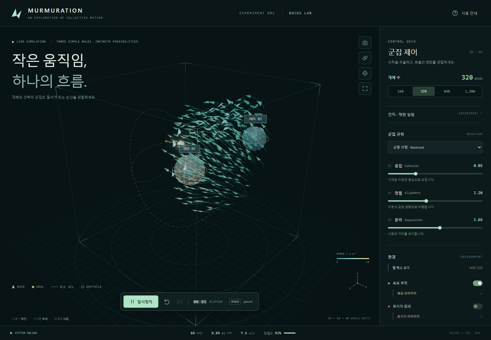

# Murmuration — Boids 기술 문서

[프로젝트 README](../README.md) · [이론과 수식](boids-theory.md) ·
[이웃 탐색](neighbor-search.md) · [성능 측정](performance.md) · [코드 구조](architecture.md)

C++20/WebAssembly로 군집 행동을 계산하고 Three.js/WebGL로 관찰하는 Boids 프로젝트입니다.
이 문서들은 세 가지 규칙이 실제 속도·위치 변화로 이어지는 과정과,
그 이웃을 효율적으로 찾기 위한 자료구조를 소스에 연결해 설명합니다.

## 읽는 순서

| 순서 | 문서                                     | 다루는 질문                                                  |
| ---- | ---------------------------------------- | ------------------------------------------------------------ |
| 1    | [Boids 이론과 수식](boids-theory.md)     | 분리·정렬·응집은 무엇이며 한 스텝에서 무엇을 계산하는가?     |
| 2    | [이웃 탐색 알고리즘](neighbor-search.md) | 가까운 개체를 어떻게 찾고, 왜 후보와 실제 이웃을 구분하는가? |
| 3    | [성능 측정](performance.md)              | 전수 탐색·Grid·KdTree를 어떤 조건과 지표로 비교하는가?       |
| 4    | [아키텍처](architecture.md)              | C++·JS·렌더러가 어떤 상태와 자원을 소유하는가?               |

## 핵심 원리

| 규칙 | 행동                               | 이 구현에서 사용하는 이웃                 |
| ---- | ---------------------------------- | ----------------------------------------- |
| 분리 | 너무 가까운 개체에게서 멀어집니다. | 인지 반경과 분리 반경 안의 모든 방향 이웃 |
| 정렬 | 평균 속도에 맞춥니다.              | 인지 반경·시야각을 통과한 이웃            |
| 응집 | 평균 위치로 향합니다.              | 인지 반경·시야각을 통과한 이웃            |

수식 문서는 인지 반경·시야각·가중치·최대 조향·속력 제한을 코드와 같은 순서로 설명합니다.
세 개체의 숫자 예시로 평균 위치와 속도, 분리 벡터, 다음 위치까지 계산할 수 있습니다.

## 구현을 읽을 때

| 관심사           | 시작할 소스                                                                                              |
| ---------------- | -------------------------------------------------------------------------------------------------------- |
| 한 스텝의 순서   | [Simulation.cpp](../native/bindings/Simulation.cpp)                                                      |
| 군집 규칙과 적분 | [BirdFlock.cpp](../native/src/simulation/BirdFlock.cpp)                                                      |
| 탐색 방법 선택   | [NeighborSearch.cpp](../native/src/simulation/NeighborSearch.cpp)                                           |
| Grid·KdTree 구현 | [SpatialGrid.cpp](../native/src/simulation/SpatialGrid.cpp), [KdTree.cpp](../native/src/simulation/KdTree.cpp) |
| 상수·기본 설정   | [SimulationConstants.h](../native/src/core/SimulationConstants.h), [config.js](../src/config.js)         |

## 실행·빌드 문서

- [C++/Wasm 개발](cpp-core.md): SDK·코어 빌드·ABI·메모리 계약.
- [VS Code 설정](vscode.md): 네이티브 빌드·디버깅 진입점.
- [Windows 배포](desktop.md): Electron 실행파일 생성과 확인.
- [검증 방법](verification.md): 단위·네이티브·브라우저 검사 실행법.
- [공통 설계 규약](project-conventions.md): 책임·수명·폴더·문서 형식.

이론·알고리즘 문서의 소스 확인일은 2026-10-26입니다. 성능 표는 원본 JSON을 보존한
기존 측정이며, 이미지도 기존 실행 캡처입니다. 이번 문서 작성의 새 성능 측정으로
표현하지 않습니다. Boids 개념의 출처와 이 구현의 구체 선택은
[참고 자료](boids-theory.md#참고-자료)에서 구분합니다.
