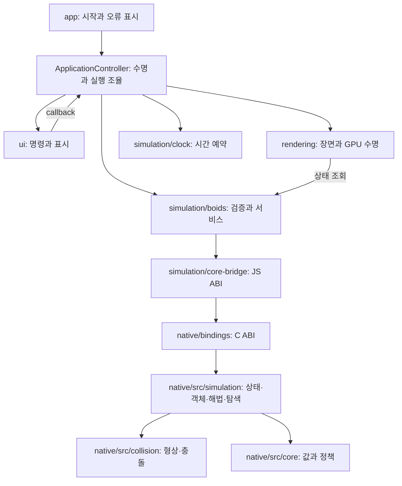

# 코드 구조와 책임

공통 설계·코딩·문서 형식은 [프로젝트 공통 규칙](project-conventions.md)을 따릅니다.
아래 표와 연결 흐름은 현재 소스에서 확인한 Boids의 구체 계약입니다.

군집 동작의 수식과 숫자 예시는 [Boids 이론](boids-theory.md), 탐색의 가지치기·복잡도는
[이웃 탐색](neighbor-search.md), 측정 조건과 기존 기록은 [성능 측정](performance.md)을
확인합니다. 처음 읽는 경우 [기술 문서 안내](README.md)에서 시작합니다.

## 책임표

| 계층 | 파일·폴더 | 책임 |
| --- | --- | --- |
| 부트스트랩 | [src/app.js](../src/app.js) | 앱 생성·시작, 오류 표시·입력 비활성화 |
| 앱 조율 | [ApplicationController](../src/application-controller.js) | 명명된 명령, 고정 스텝·계측·선택 상태, 프레임·이벤트·자원 수명 |
| 시뮬레이션 서비스 | [boids.js](../src/simulation/boids.js) | 입력 검증, 설정·맵·장애물 명령, 수치 상태 조회 |
| 시간 예약 | [clock.js](../src/simulation/clock.js) | 고정 스텝 누적, 제한된 따라잡기와 표시 보간 비율 |
| JS ABI 어댑터 | [core-bridge.js](../src/simulation/core-bridge.js) | WASM 인스턴스·슬롯 매핑·설정 포장·TypedArray 대여 |
| 렌더링 | [scene.js](../src/rendering/scene.js) | Three.js 장면·GPU 업로드·보간·카메라·선택·GPU 해제 |
| UI | [controls.js](../src/ui/controls.js) | DOM 이벤트·입력·표시 동기화, 앱에 명령 전달 |
| 진단 표시 | [diagnostics.js](../src/ui/diagnostics.js) | 상태를 읽어 DOM dataset과 위치 bit hash 발행, 수치 상태 변경 없음 |
| 공개 ABI | [boids.h](../native/bindings/include/boids/boids.h) | C ABI v1 함수·selector·배열 타입과 길이 |
| C++ ABI·실행 조율 | [native/bindings/](../native/bindings/), [Simulation.h](../native/bindings/Simulation.h) | C 함수 전달·원본 배열 변환, 도메인 소유와 갱신 순서를 잇는 host-facing 코디네이터 |
| 월드 상태 | [SimulationState.h](../native/src/simulation/SimulationState.h) | private 상태·시간/위상/보간 전이와 const snapshot 조회 |
| 개체 | [native/src/simulation/](../native/src/simulation/) | Bird 버퍼·군집·적분·경계·진단, Goal·Predator 상태 |
| 공간 탐색 | [native/src/simulation/](../native/src/simulation/) | Grid·KdTree·검색 선택과 후보 scratch |
| 장애물 | [native/src/collision/](../native/src/collision/) | 형상·표면 거리·회피 거리와 활성 형상 소유 |
| 공통 값·정책 | [native/src/core/](../native/src/core/) | 벡터·축·경계·상수·설정과 순수 수학 연산 |

## 의존 흐름

이 그림은 실행 시 호출 흐름입니다. `FSimulation`은 순수 도메인 월드가 아니라
`native/bindings/`의 host-facing 코디네이터입니다. `FSimulationAbi`와 도메인 객체를 소유하여
입력 스냅샷·계산 순서·출력 슬롯 publication을 연결합니다. `native/src/`는 bindings의 비공개 헤더를
참조하지 않습니다. 다만 공개 `boids.h`의 최대 용량과 공유 상수 계약을 참조하므로
도메인이 공개 ABI 스키마까지 완전히 독립된 구조라고 주장하지 않습니다.
DOM·Three.js는 C++ 코어와 JS 시뮬레이션 모듈에 추가하지 않습니다. UI는 C ABI 슬롯을
다루지 않으며, 렌더링은 명령의 부작용과 수치 적분을 소유하지 않습니다.

## 소유권·수명

| 소유자 | 소유 자원 | 대여·무효화 계약 |
| --- | --- | --- |
| ApplicationController | Simulation·Clock·Scene·ControlPanel, RAF·AbortController | 생성 실패·프레임 실패·종료 시 RAF 취소→이벤트 중단→UI→Scene→Simulation 해제 |
| BoidSimulation·BoidsCoreBridge | 독립 WASM 인스턴스 exports와 메모리의 JS 뷰 | dispose는 중복 호출을 허용합니다. 이후 명령·getter는 오류를 내고 직접 data 필드는 null이 됩니다. |
| FSimulation | Abi·Config·State·Obstacles·Birds·Goal·Predator 값 | 복사·이동을 금지합니다. ABI 대여 포인터를 호출자가 해제하지 않습니다. |
| FBirdFlock | 위치·이전 위치·속도 A/B·진단 vector, unique_ptr 검색 객체 | 저장소는 생성 후 크기를 유지합니다. 현재·다음 속도 역할만 교체합니다. |
| FNeighborSearch | Grid·Tree와 후보 vector | 후보는 const 참조로 읽고 다음 Rebuild/조회 전에 소비합니다. |
| FKdTree | 공간 인덱스·분할축·분할좌표 배열 | 위치 버퍼는 Rebuild 호출 동안만 읽습니다. 이후 조회는 내부 스냅샷을 사용하며 새 위치에는 재구축이 필요합니다. |
| FObstacleSet | reserve(16)한 vector<unique_ptr<FObstacle>> | 같은 형상은 재사용합니다. 교체·제거·소유자 파괴 후 형상 참조는 무효입니다. |
| BoidScene | Three.js geometry·material·texture·controls·ResizeObserver | 생성 중 실패도 이미 생성한 자원과 canvas를 해제합니다. dispose는 중복 호출을 허용합니다. |
| ControlPanel | DOM 이벤트 AbortController·toast 타이머 | 초기 이벤트 등록·sync 실패와 dispose에서 이벤트와 타이머를 중단합니다. |

근거는 [Simulation.h](../native/bindings/Simulation.h),
[BirdVectorBuffer.h](../native/src/simulation/BirdVectorBuffer.h),
[NeighborSearch.h](../native/src/simulation/NeighborSearch.h),
[ObstacleSet.cpp](../native/src/collision/ObstacleSet.cpp),
[Scene.dispose](../src/rendering/scene.js), [ControlPanel.dispose](../src/ui/controls.js)입니다.

브라우저의 수치 저장소는 초기 2 MiB·메모리 성장 금지의 WASM 인스턴스에 속합니다.
ABI v1에는 destroy export가 없습니다. 서비스 dispose는 자신이 소유한 exports·뷰 참조를
제거하며, 외부에 이미 빌려준 TypedArray나 raw exports를 revoke하지 못합니다. 기존 대여
값은 dispose 뒤 사용하지 않습니다. 외부 참조까지 도달 불가능해진 뒤 메모리를 GC가
회수할 수 있으며 즉시 native free나 메모리 detach를 수행한다고 주장하지 않습니다.
네이티브 `FSimulation`의 C++ 수명과 브라우저 WASM 인스턴스의 수명을 구분합니다. 후보 scratch는 사전 예약 용량 내에서
크기를 바꿀 수 있습니다. 초기 장애물 활성화·종류 교체·축소/재활성화의 할당과 해제는
허용하며, 입력이 그대로인 정상 스텝의 할당 계약과 구분합니다.

### 상태와 불변식

- 설정·상태·장애물 원본 배열은 `FSimulationAbi`만 해석합니다. 도메인은
  `Config.PerceptionRadius`, `Config.Bounds.HalfExtents`, `State.GetSnapshot().SimulationTime`으로 읽습니다.
- `FSimulationStateSnapshot`은 ABI import와 독립 복사를 위한 값입니다. `FSimulationState`는
  이 값을 private으로 소유하며 시간·위상·보간 변경을 `AdvanceTime`, `SnapGoalInterpolation`,
  `ResetForBirdCount` 명령으로 묶습니다. `GetSnapshot()`의 const 참조는 객체 수명에 종속되고
  다음 명령에서 내용이 바뀝니다. 이전 값을 보존하려면 snapshot을 값으로 복사합니다.
  ABI의 외부 쓰기와 전체 상태 재수입은 기존대로 허용합니다. Reset은 통계 4개를 지우지
  않으며 다음 `SetFlockMetrics` 측정이 덮어씁니다.
- [SimulationAbi.cpp](../native/bindings/SimulationAbi.cpp)의 `PublishResetState`는
  상태 10개, `PublishStepState`는 활성 수를 제외한 9개, 목표 보간은 슬롯 3/4,
  군집 계측은 슬롯 6~9만 기록합니다. 작업의 출력 대상이 아닌 슬롯은 덮어쓰지 않습니다.
- `FBirdVectorBuffer`는 private `std::vector<float>`로 연속 저장소를 소유합니다.
  개체/축 접근은 `BirdIndex`와 `EAxis`를 사용하며 flat offset은 버퍼 내부에서 계산합니다.
- 계산은 `FVector3D(double)`, actor 저장은 `FVector3f(float 배열)`입니다.
  누적 순서·hypot·float 저장 시점을 유지합니다. XYZ 멤버를 배열 포인터로 재해석하지 않습니다.
- 모든 Bird는 같은 위치·속도 스냅샷을 읽습니다. 다음 속도를 모두 계산한 뒤 버퍼 역할을
  한 번 교체합니다. selector 4/5는 현재 역할을 다시 조회합니다.
- 후보는 `const std::vector<int>&`로 대여합니다. Grid·Tree의 자료구조와 후보 순서를
  보존하고, 정확 거리·시야각·합산은 [BirdFlock.cpp](../native/src/simulation/BirdFlock.cpp)가 담당합니다.
- 인지 반경·반경 제곱·시야각 코사인은 `FNeighborhoodQuery`에 모아 군집 명령마다 한 번
  계산합니다. 명령 사이에 캐시하지 않으므로 설정 변경은 다음 명령에 반영됩니다.
  개체별 속도에 따른 시야 필터 활성화와 이웃 합산 순서는 그대로 유지합니다.

### 이웃 계산을 읽는 순서

[BirdFlock.cpp](../native/src/simulation/BirdFlock.cpp)의 `CollectNeighborhood`는 후보를
다음 순서로 처리합니다. `AwayFromNeighbor`는 이웃에서 자신으로 향하는 벡터이므로
시선 판정은 `-Velocity.Dot(AwayFromNeighbor)`를 사용합니다.

| 단계 | 판정·출력 | 보존할 이유 |
| --- | --- | --- |
| 후보 | Grid/KdTree 결과를 원래 순서로 순회 | 후보 순서가 double 합산 순서에 영향을 줍니다. |
| 거리 | 자신 제외 후 검사 수 증가, 인지 반경 밖 제외 | 검사 수와 실제 이웃 수는 다른 진단입니다. |
| 분리 | 근접 이웃의 역거리 가중 합, 겹침은 개체 ID로 방향 결정 | 시야 밖 근접 개체도 분리 대상입니다. |
| 시야 | 속도가 있고 시야가 360도 미만일 때만 FOV 적용 | 정지 개체의 방향을 임의로 정하지 않습니다. |
| 가시 이웃 | 위치·속도 합과 선택적 inspection 기록 | 진단 호출은 위치·속도·다음 궤적을 바꾸지 않습니다. |

예를 들어 기존 [logic.test.js](../tests/unit/logic.test.js)의 60도 시야 장면은
자신이 (0,0,0), 이웃이 (0,0,-1), 속도가 +Z일 때 가시 이웃 0개·근접 이웃 1개와
+Z 분리력을 검증합니다. 따라서 FOV를 분리 계산 앞으로 옮기면 동작 계약이 깨집니다.
`CalculateFlockingForces`는 const 계산으로 응집·정렬·분리 성분을 반환합니다.
`EvaluateFlocking`의 힘 합산은 `(Separation + Cohesion) + Alignment` 순서를 유지합니다.
진단 기록은 `PublishBirdInspection`이 담당하며 기존처럼 각 축의 세 힘을 기록한 뒤
이웃 수·근접 이웃 수를 기록합니다. 일반 스텝의 힘 계산은 Inspection 배열을 변경하지 않습니다.

### 한 스텝의 순서

1. 설정·상태·장애물 입력을 읽고 이전 개체 위치와 목표 위상을 보관합니다.
2. 시간·목표·포식자를 갱신하고 현재 개체 위치로 탐색 구조를 재구축합니다.
3. `IntegrateNextVelocities`가 동일한 스냅샷에서 모든 다음 속도를 계산합니다.
4. `CommitVelocitiesAndIntegratePositions`가 속도 역할을 교체하고 위치를 적분합니다.
5. 장애물·경계를 적용하고 상태 계측을 기록한 뒤 `PublishStepState`가 상태 슬롯 1~9를 출력합니다.

구현 근거는 [Simulation.cpp](../native/bindings/Simulation.cpp)와
[BirdFlock.cpp](../native/src/simulation/BirdFlock.cpp)입니다.

## 명령·조회·실패

| 종류 | 진입점 | 계약 |
| --- | --- | --- |
| 명령 | updateSettings·resizeWorld·장애물 편집 | JS 서비스에서 검증한 뒤 상태에 반영합니다. |
| 명령 | reset·step·updatePredator | seed·dt를 검증합니다. step의 dt는 (0, 0.05]초입니다. |
| 조회 | count·time·positions·velocities·metrics | 상태와 대여 메모리를 읽습니다. 속도 뷰 역할 변경을 구분합니다. |
| 진단 명령 | inspect·refreshNeighborhoodCounts·measure | 순수 조회가 아닙니다. 진단 버퍼 또는 계측 상태를 갱신합니다. |
| 순수 대여 | FSimulation::GetAbiBuffer | 입력 재동기화·계산·할당 없이 기존 backing buffer를 반환합니다. |
| 실패 | 입력 검증·WASM/렌더러 초기화 | JS 예외 또는 앱 오류 표시로 전달합니다. 앱 실패 시 수명을 종료하고 재시작 버튼은 유지합니다. |
| 종료 | dispose | 중복 호출을 허용합니다. 종료 후 서비스 명령과 getter는 disposed 오류를 냅니다. 기존 대여 값은 사용하지 않습니다. |

장애물·맵 편집은 [obstacles.js](../src/simulation/obstacles.js)와
[world-bounds.js](../src/simulation/world-bounds.js)에서 유한값·범위·배치 조건을 검증합니다.
[boids.js](../src/simulation/boids.js)가 서비스 계약을 연결합니다. 설정은 candidate를
검증·포장한 뒤 UI가 빌린 기존 settings 객체에 반영합니다.
[core-bridge.js](../src/simulation/core-bridge.js)는 grid 용량·경계·장애물 수와 모든 장애물
레코드를 해당 ABI 배열의 첫 쓰기 전에 검사합니다. 이 계약은
[config-transaction.test.js](../tests/unit/config-transaction.test.js)에서 실패 전후 바이트와
이후 30스텝 궤적으로 확인합니다.

[ApplicationController](../src/application-controller.js)가 명령·프레임·정리를 소유하고,
[app.js](../src/app.js)가 입력 비활성화·오류 표시를 담당합니다.
Controller의 `createActions`는 UI 명령을 연결하며 실제 실행은 `configure`, `restart`,
`singleStep`, `togglePause`, `resizeWorld` 등 명명된 메서드가 담당합니다.
`frame`은 고정 스텝 → 표시 → 계측 순서이고 `resumeVisible`은 숨겨진 시간의 따라잡기를 초기화합니다.
초기 RAF 예약 실패도 완성된 자원을 정리합니다.
[application-controller.test.js](../tests/unit/application-controller.test.js)는 실제 Wasm과 가짜 화면 자원을
조합하여 명령·재현·부분 초기화·숨김·반복 종료·프레임 실패의 소유권을 검사합니다.
[construction.mjs](../tests/browser/construction.mjs)는 실제 Three.js/OrbitControls/DOM에서
controls 생성, ResizeObserver.observe, UI 이벤트 등록과 최초 sync 실패를 주입하여
canvas·붙어 있는 geometry/material/texture·이벤트·observer 정리를 확인합니다.
C++의 예외·RTTI는 비활성화합니다. 프로젝트별 자원 해제 방법은 서비스 dispose 내부에 격리합니다.

## 빌드 산출물

| 구분 | 경로·명령 | 규칙 |
| --- | --- | --- |
| 공통 구현 목록 | [native/sources.txt](../native/sources.txt) | CMake와 Wasm이 같은 순서의 구현 목록을 읽습니다. |
| 원본 해시 | [tools/core-sources.mjs](../tools/core-sources.mjs) | 구현·재귀 수집 헤더·목록·CMake·Wasm 도구의 UTF-8/LF 정규화 텍스트를 포함합니다. Wasm 바이너리 체크섬은 원본 바이트를 사용합니다. |
| 네이티브 | 루트 CMakeLists.txt, build/native/ | 과거 캐시는 build/style-unification-baseline/에 보존하고 공통 경로로 새 구성합니다. |
| Wasm | npm run build:core | Emscripten 4.0.23, C++20, strict FP, 고정 2 MiB, 외부 import 없음 |
| 웹 | npm run build | src/app.js에서 dist/app.js 생성, index.html에서 yoosh.html 갱신 |
| 데스크톱 | npm run build:exe | 별도 staging manifest로 필요한 파일만 Windows EXE에 포함 |
| 검사 | npm test, npm run test:native, npm run test:browser | 수치·네이티브·브라우저 결과를 각각 기록 |

생성된 `src/simulation/generated/`, `dist/`, `yoosh.html`은 직접 편집하지 않습니다.
[check-core.mjs](../tools/check-core.mjs)가 저장된 코어의 원본 해시와 바이너리 해시를 확인합니다.
네이티브 통과는 실제 WASM·브라우저·GPU 실행 증거를 대체하지 않습니다.
최신 실행 결과와 이번 리뷰 이력은 공통 규칙 문서에서 연결하는 검증 기록을 따릅니다.

세부 구현 계약은 [프로젝트 규칙](cpp-project-rules.md), 실행 검사는 [검증 방법](verification.md)을 확인합니다.

## ABI 스키마 연결

[boids.h](../native/bindings/include/boids/boids.h)는 버퍼 selector·원소 타입·용량·단위·상태 슬롯의 쓰기 소유자·
검증 책임과 대여 수명을 공개합니다. `ECoreBuffer`는 공개 헤더에 한 번만 정의합니다.
`boids_abi_schema()`는 실제 C++ enum·원소 크기·용량·레코드 offset으로 FNV-1a word 서명을 계산하며
[core-bridge.js](../src/simulation/core-bridge.js)는 이름 있는 JS 스키마로 만든 서명과 대조합니다.
버전이 같더라도 서명이 없거나 다르면 TypedArray를 만들기 전에 거부합니다.
이는 슬롯 연결 실수 검출용이며 보안 서명이나 입력 검증을 대신하지 않습니다.
[abi-schema.test.js](../tests/unit/abi-schema.test.js)는 실제 재빌드한 Wasm과의 일치 및
틀린 버전·누락·변경된 서명의 거부를 검사합니다.

C++ 파일의 공통 배치와 기존 경로의 이동 기준은 [native 내부 구조](native-layout.md)를 따릅니다.
