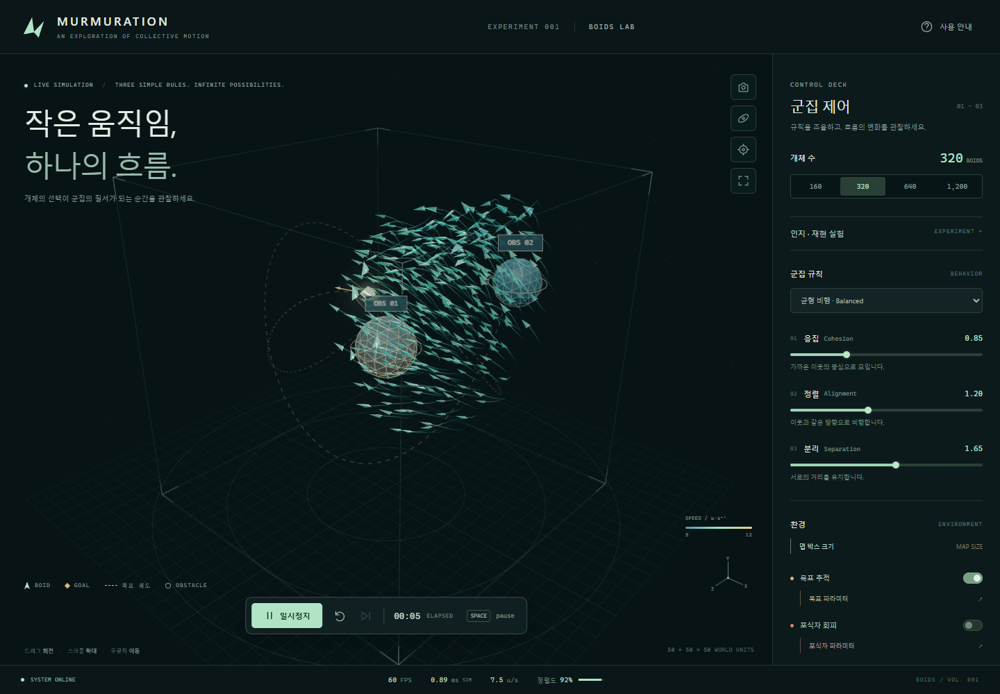
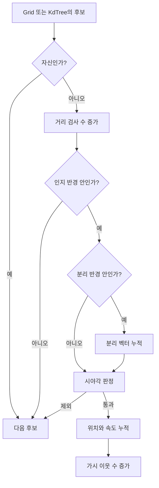

# Boids의 원리와 이 구현의 수식

[문서 안내](README.md) · [이웃 탐색](neighbor-search.md) · [코드 구조](architecture.md)

Boids는 각 개체가 주변 개체의 위치·속도에 반응하도록 하여 군집 운동을 만드는
행동 모델입니다. 분리·정렬·응집이라는 기본 개념은
[Craig Reynolds의 Boids 설명](https://www.red3d.com/cwr/boids/)을 따릅니다.
아래 수식의 계수·예외 처리·갱신 순서는 **이 저장소의 C++ 구현**을 설명합니다.
Reynolds 원문의 수식을 그대로 재현했다는 의미는 아닙니다.

소스 확인 기준일은 2026-10-26입니다. 핵심 구현은
[BirdFlock.cpp](../native/src/simulation/BirdFlock.cpp), 상수는
[SimulationConstants.h](../native/src/core/SimulationConstants.h), UI 기본값은
[config.js](../src/config.js)에 있습니다.

## 1. 세 가지 행동을 조합합니다

| 규칙             | 개체가 하는 판단                   | 이 구현의 계산                                               |
| ---------------- | ---------------------------------- | ------------------------------------------------------------ |
| 분리, Separation | 너무 가까운 이웃에게서 멀어집니다. | 이웃에서 자신으로 향하는 벡터를 거리 제곱으로 나눠 합합니다. |
| 정렬, Alignment  | 주변 개체의 속도에 맞춥니다.       | 가시 이웃의 평균 속도에서 자신의 속도를 뺍니다.              |
| 응집, Cohesion   | 주변 군집의 중심으로 향합니다.     | 가시 이웃의 평균 위치에서 자신의 위치를 뺍니다.              |

각 행동이 가속도에 기여하고, 합성한 가속도로 속도와 위치를 갱신합니다.
코드의 `Force`는 질량으로 나누지 않고 속도에 적용하므로 가속도 역할의 조향 벡터입니다.
위치는 프로젝트의 월드 단위, 시간은 초를 사용합니다. 계수는 군집 행동을 조절하는 값이며
실제 새의 질량·양력·항력을 측정한 물리 상수가 아닙니다.



저장소에 있던 브라우저 실행 캡처를 보존했습니다. 화면 하단의 순간 표시값은
[반복 측정 결과](performance.md)와 구분합니다.

## 2. 상태와 이웃을 정의합니다

| 기호                        | 뜻                            | 코드·기본값                                      |
| --------------------------- | ----------------------------- | ------------------------------------------------ |
| $\mathbf{x}_i,\mathbf{v}_i$ | 개체 $i$의 현재 위치·속도     | `Positions`, `Velocities`                        |
| $R$                         | 인지 반경                     | `PerceptionRadius`, 기본 10                      |
| $r_s$                       | 분리 반경                     | `SeparationRadius = 3.2`                         |
| $\theta$                    | 전체 시야각                   | `FieldOfViewDegrees`, 기본 360도                 |
| $w_s,w_a,w_c$               | 분리·정렬·응집 가중치         | 기본 1.65, 1.2, 0.85                             |
| $\Delta t$                  | 한 스텝의 시간                | 앱의 고정 스텝 $1/60$초                          |
| $\varepsilon,\tau$          | 작은 값·시야 경계 비교 허용값 | `Epsilon = 1e-8`, `FieldOfViewTolerance = 1e-10` |

`Epsilon`은 [MathUtils.h](../native/src/core/MathUtils.h)에 있습니다. 코드에서 거리와
거리 제곱에 같은 상수를 사용하는 지점이 있으므로 아래의 비교 대상도 그대로 구분합니다.

먼저 $\mathbf{d}_{ij}=\mathbf{x}_j-\mathbf{x}_i$, $q_{ij}=\|\mathbf{d}_{ij}\|^2$로 둡니다.
인지 반경 안의 집합은 다음과 같습니다. 경계 $q_{ij}=R^2$는 제외합니다.

$$
\mathcal{P}_i=\{j\mid j\ne i,\ q_{ij}<R^2\}
$$

분리 대상은 다음 집합입니다. **분리에는 시야각 필터를 적용하지 않습니다.**

$$
\mathcal{S}_i=\{j\in\mathcal{P}_i\mid q_{ij}<r_s^2\}
$$

응집·정렬에 사용하는 가시 이웃 집합을 $\mathcal{V}_i$라고 합니다.
$\theta<360$도이고 $\|\mathbf{v}_i\|^2>\varepsilon$이며
$q_{ij}\ge\varepsilon$인 경우에는 다음 조건을 통과해야 합니다.

$$
\mathbf{v}_i\cdot\mathbf{d}_{ij}
\ge
\cos\!\left(\frac{\theta\pi}{360}\right)
\sqrt{\|\mathbf{v}_i\|^2 q_{ij}}-\tau
$$

전체 시야각의 절반과 진행 방향 사이의 각도를 비교하는 식입니다. 세 조건 중 하나라도
성립하지 않으면 시야각으로 제외하지 않습니다. 정지에 가까운 개체나 거의 겹친 이웃처럼
진행 방향 또는 이웃 방향을 정의하기 어려운 경우에는 시야각 판정을 생략합니다.

예를 들어 자신이 `(0,0,0)`에서 `+Z`로 이동하고 이웃이 `(0,0,-1)`에 있다면,
60도 시야에서 그 이웃은 응집·정렬 대상에서 제외되지만 분리 대상에는 포함됩니다.
구현은 [CollectNeighborhood](../native/src/simulation/BirdFlock.cpp#L200), 해당 사례는
[logic.test.js](../tests/unit/logic.test.js#L123)에 있습니다.



## 3. 세 가지 조향 벡터를 계산합니다

### 분리: 가까울수록 강하게 밀어냅니다

$$
\mathbf{s}_i=13w_s\sum_{j\in\mathcal{S}_i}\mathbf{b}_{ij},
\qquad
\mathbf{b}_{ij}=
\begin{cases}
(-1,0,0), & q_{ij}<\varepsilon\ \text{and}\ i<j\\
(1,0,0), & q_{ij}<\varepsilon\ \text{and}\ i>j\\
\dfrac{\mathbf{x}_i-\mathbf{x}_j}{q_{ij}}, & q_{ij}\ge\varepsilon
\end{cases}
$$

일반 분기의 벡터 크기는 $1/\sqrt{q_{ij}}$입니다. 벡터 자체를 거리 제곱으로 나누므로
힘의 크기가 거리의 제곱에 반비례한다고 해석하면 안 됩니다. 이웃 수로 평균 내거나
최종 분리 방향을 단위 벡터로 만들지도 않습니다.

거의 겹친 두 개체에는 ID에 따라 반대 X 방향을 부여합니다. 분모를 작게 제한하는
방식이 아니라 별도 방향을 선택하는 분기입니다. 따라서 이 특수 상황에서는 ID를
바꾸면 선택 방향도 바뀔 수 있습니다.

### 응집: 보이는 이웃의 중심으로 향합니다

$m=|\mathcal{V}_i|>0$일 때 다음과 같습니다.

$$
\overline{\mathbf{x}}_i=\frac{1}{m}\sum_{j\in\mathcal{V}_i}\mathbf{x}_j,
\qquad
\mathbf{c}_i=0.6w_c(\overline{\mathbf{x}}_i-\mathbf{x}_i)
$$

같은 가중치라면 중심에서 멀수록 큰 벡터가 됩니다. 자신의 위치는 평균에 포함하지 않습니다.

### 정렬: 평균 속도와의 차이를 줄입니다

$$
\overline{\mathbf{v}}_i=\frac{1}{m}\sum_{j\in\mathcal{V}_i}\mathbf{v}_j,
\qquad
\mathbf{a}_i=w_a(\overline{\mathbf{v}}_i-\mathbf{v}_i)
$$

이 구현은 속도 벡터를 평균 내므로 방향과 속력 모두에 반응합니다.
가시 이웃이 없으면 $\mathbf{c}_i=\mathbf{a}_i=\mathbf{0}$으로 두어 0으로 나누지 않습니다.

군집 조향의 합은 다음 순서로 계산합니다. 괄호는 실제 합산 순서를 나타냅니다.

$$
\mathbf{f}_{\mathrm{flock},i}=(\mathbf{s}_i+\mathbf{c}_i)+\mathbf{a}_i
$$

계수 적용은 [CalculateFlockingForces](../native/src/simulation/BirdFlock.cpp), 합산은 같은 파일의
`EvaluateFlocking`에 있습니다.

## 4. 목표·포식자·장애물·경계를 적용합니다

`AccumulateExternalForces`는 군집 조향에 목표 → 포식자 → 장애물 순서로 더한 뒤
경계 조향을 혼합합니다. 각 기능을 꺼 두면 해당 항은 적용하지 않습니다.

| 기능        | 적용 방식                                                                                      | 구현                                                                        |
| ----------- | ---------------------------------------------------------------------------------------------- | --------------------------------------------------------------------------- |
| 목표        | 목표 위치 $\mathbf{g}$를 향해 $0.28w_g(\mathbf{g}-\mathbf{x}_i)$를 더합니다.                   | [Goal.cpp](../native/src/simulation/Goal.cpp)                                   |
| 포식자 회피 | 회피 반경 안에서 포식자 반대 방향으로 조향하며 거리에 따라 감쇠합니다.                         | [Predator.cpp](../native/src/simulation/Predator.cpp)                           |
| 장애물 회피 | 미래 예상 위치의 표면 거리와 바깥 법선으로 회피 벡터를 만듭니다.                               | [AccumulateObstacleAvoidanceForce](../native/src/simulation/BirdFlock.cpp#L350) |
| 경계 조향   | 안쪽으로 유도하고 정면 접근에는 접선 성분도 더합니다. 맵 밖에서는 기존 조향의 비중을 낮춥니다. | [CalculateBoundarySteering](../native/src/simulation/BirdFlock.cpp#L397)        |

포식자는 매 스텝 Bird 전체의 평균 위치를 추적합니다. 개별 Bird의 국소 이웃 규칙과는
별도의 actor 동작입니다. 목표도 정해진 궤도를 따라 이동하므로 전체 장면의 모든 행동이
국소 군집 규칙만으로 결정되는 것은 아닙니다.

장애물 회피의 예상 위치는 $\mathbf{x}_i+0.45\mathbf{v}_i$입니다. 이 위치에서의
부호 있는 표면 거리 $d$가 4보다 작으면 다음 조향을 더합니다.

$$
\mathbf{f}_{\mathrm{obstacle}}=
55\min\!\left(1,\frac{4-d}{L}\right)\mathbf{n}
$$

$\mathbf{n}$은 바깥 법선입니다. 구는 $L=\text{radius}+4$, 박스는 $L=4$를 사용합니다.
구의 거리는 $\|\mathbf{x}-\mathbf{o}\|-\text{radius}$이며, 축 정렬 박스는
$\mathbf{q}=|\mathbf{x}-\mathbf{o}|-\mathbf{h}$에 대해
$\|\max(\mathbf{q},0)\|+\min(\max(q_x,q_y,q_z),0)$에 해당하는 계산을 합니다.
$\mathbf{o}$는 중심, $\mathbf{h}$는 박스 반크기입니다. 내부의 법선 동률은 X → Y → Z로 결정합니다.
근거는 [SphereObstacle.cpp](../native/src/collision/SphereObstacle.cpp)와
[BoxObstacle.cpp](../native/src/collision/BoxObstacle.cpp)입니다.

적분 후에도 표면 거리가 0.65보다 작으면 위치를 법선 방향으로 보정합니다.
표면 안쪽으로 향하는 속도 성분은 `v -= 1.5 * dot(v, n) * n`으로 바꿉니다.
예측 회피와 사후 위치 보정은 별도 단계입니다. 선분 전체를 검사하는 연속 충돌 검출은 아닙니다.

| 경계 모드 | 적분 전 조향 | 적분 후 위치·속도 처리                                         |
| --------- | ------------ | -------------------------------------------------------------- |
| Hard      | 없음         | 경계 밖 좌표를 면에 고정하고 해당 축 속도를 안쪽으로 바꿉니다. |
| Soft      | 있음         | 월드 경계로 위치를 고정하지 않아 일시 이탈을 허용합니다.       |
| Hybrid    | 있음         | Hard와 같은 사후 경계 처리를 적용합니다.                       |

Soft·Hybrid에서 최종 조향은 $(1-\beta)\mathbf{f}+\mathbf{f}_{\mathrm{boundary}}$입니다.
$\beta$는 축별 경계 이탈 거리를 조향 폭으로 나눈 값의 최댓값을 0~1로 제한한 값입니다.
따라서 단순히 모든 힘을 더하는 식만으로 이 두 모드의 동작을 설명할 수 없습니다.

## 5. 속도를 먼저 갱신하고 새 속도로 이동합니다

모든 외부 동작까지 적용한 벡터를 $\mathbf{f}_i$라고 두면 다음과 같습니다.

$$
\widehat{\mathbf{f}}_i=
\mathbf{f}_i\min\!\left(1,\frac{16}{\max(\varepsilon,\|\mathbf{f}_i\|)}\right)
$$

$$
\mathbf{u}_i=\operatorname{float32}(\mathbf{v}_i+\widehat{\mathbf{f}}_i\Delta t)
$$

$s=\|\mathbf{u}_i\|$에 따라 다음 속도를 저장합니다.

$$
\mathbf{v}^{\mathrm{next}}_i=
\begin{cases}
(5,0,0), & s<\varepsilon\\
\operatorname{float32}\!\left(\mathbf{u}_i\dfrac{\operatorname{clamp}(s,5,12)}{s}\right),
& s\ge\varepsilon
\end{cases}
$$

모든 개체의 다음 속도가 완성되면 현재·다음 버퍼를 교체합니다. 이어서 위치를 갱신합니다.

$$
\mathbf{x}^{\mathrm{trial}}_i=
\operatorname{float32}(\mathbf{x}_i+\mathbf{v}^{\mathrm{next}}_i\Delta t)
$$

속도를 먼저 갱신한 뒤 새 속도로 위치를 갱신하는 semi-implicit Euler 순서입니다.
그 뒤 장애물 보정 → 월드 경계 처리 → 속력 제한을 적용하므로 위 식은 보정 전 위치입니다.
속력 5~12는 제한 목표 범위이며 float32 저장 반올림을 고려해야 합니다.
구현은 [IntegrateBirdVelocity](../native/src/simulation/BirdFlock.cpp#L123)와
[CommitVelocitiesAndIntegratePositions](../native/src/simulation/BirdFlock.cpp#L133)에 있습니다.

### 속도 이중 버퍼가 필요한 이유

한 개체를 계산할 때 즉시 현재 속도를 바꾸면 뒤쪽 개체는 이미 바뀐 속도를 읽습니다.
이 구현은 모든 개체가 같은 스텝 시작 위치·속도를 읽고 `NextVelocities`에만 기록합니다.
위치도 모든 다음 속도 계산이 끝난 뒤 변경합니다. 렌더링 보간용 `PreviousPositions`는
이 동시 갱신 계약과 별도로 이전 위치를 보관합니다.

```text
입력 동기화, 이전 위치 보관
→ 시간·목표·포식자 갱신
→ 현재 위치로 탐색 구조 재구축
→ 모든 Bird의 다음 속도 계산: 현재 위치·속도는 읽기 전용
→ 속도 버퍼 교체
→ 위치 적분, 장애물·경계 처리
→ 통계와 ABI 출력 갱신
```

전체 호출 순서는 [FSimulation::Step](../native/bindings/Simulation.cpp)에 있습니다.
[SimulationClock](../src/simulation/clock.js)은 경과 시간을 누적하여 $1/60$초씩 실행합니다.
프레임 경과 시간은 최대 0.1초까지 반영하고 한 번에 최대 12스텝을 처리합니다.
UI의 속도 배율은 이 누적 시간에 적용되며 Bird의 최소·최대 속력 상수를 바꾸지 않습니다.

## 6. 세 개체로 한 스텝을 계산합니다

다음은 설명을 위한 입력입니다. 기본 프리셋이 아닙니다. $R=10$, 시야각 360도,
$w_s=w_a=w_c=1$, $\Delta t=1/60$로 두고 목표·포식자·장애물을 끕니다.
Hard 경계 안쪽에서 계산하므로 경계 조향·접촉도 없습니다.

| 개체            | 위치      | 속도      |
| --------------- | --------- | --------- |
| 계산 대상 $i=0$ | $(0,0,0)$ | $(6,0,0)$ |
| 이웃 $j=1$      | $(2,0,0)$ | $(6,2,0)$ |
| 이웃 $j=2$      | $(0,4,0)$ | $(5,0,0)$ |

두 이웃 모두 인지 반경 안에 있고, 거리가 2인 첫 이웃만 분리 반경 3.2 안에 있습니다.

| 단계      | 계산                                      | 결과                       |
| --------- | ----------------------------------------- | -------------------------- |
| 평균 위치 | $((2,0,0)+(0,4,0))/2$                     | $(1,2,0)$                  |
| 응집      | $0.6((1,2,0)-(0,0,0))$                    | $(0.6,1.2,0)$              |
| 평균 속도 | $((6,2,0)+(5,0,0))/2$                     | $(5.5,1,0)$                |
| 정렬      | $(5.5,1,0)-(6,0,0)$                       | $(-0.5,1,0)$               |
| 분리      | $13(-2,0,0)/4$                            | $(-6.5,0,0)$               |
| 합성 조향 | 분리 + 응집 + 정렬                        | $(-6.4,2.2,0)$             |
| 다음 속도 | $(6,0,0)+(-6.4,2.2,0)/60$                 | 약 $(5.893333,0.036667,0)$ |
| 다음 위치 | $(0,0,0)+\mathbf{v}^{\mathrm{next}}_i/60$ | 약 $(0.098222,0.000611,0)$ |

합성 조향의 크기는 16보다 작고 다음 속력은 5~12 안이므로 이 사례에서는 제한으로
방향·크기가 추가 변경되지 않습니다. 표의 마지막 두 행은 float32 저장 후 소수점 여섯
자리로 반올림했습니다. 이웃 두 개체도 자신의 이웃을 기준으로 별도로 계산합니다.

문서 작성 때 저장된 Wasm과 현재 C++ 소스의 해시 일치를 확인한 뒤 위 입력을 실제
`BoidSimulation`에 적용했습니다. 세 조향 성분과 표의 다음 속도·위치가 일치했습니다.
다음 코드를 저장소 루트의 Node.js ES module 환경에서 실행하면 같은 예시를 확인할 수 있습니다.

```javascript
import { BoidSimulation } from './src/simulation/boids.js';
import { FIXED_DT } from './src/config.js';

const simulation = new BoidSimulation({
  count: 3,
  perception: 10,
  fieldOfView: 360,
  cohesion: 1,
  alignment: 1,
  separation: 1,
  goal: false,
  predator: false,
  obstacles: false,
  boundaryMode: 'hard',
});
simulation.positions.set([0, 0, 0, 2, 0, 0, 0, 4, 0]);
simulation.velocities.set([6, 0, 0, 6, 2, 0, 5, 0, 0]);
simulation.previousPositions.set(simulation.positions);
const info = simulation.inspect(0);
console.log(Array.from(info.cohesion), Array.from(info.alignment), Array.from(info.separation));
simulation.step(FIXED_DT);
console.log(Array.from(simulation.velocities.slice(0, 3)));
console.log(Array.from(simulation.positions.slice(0, 3)));
simulation.dispose();
```

이 예시는 계산 검토를 위해 초기 버퍼를 직접 설정합니다. 일반 UI의 설정 변경은
검증이 있는 시뮬레이션 명령 API를 사용합니다.

## 7. 코드와 연결해 확인합니다

| 확인할 내용                      | 읽을 위치                                                                                                                         |
| -------------------------------- | --------------------------------------------------------------------------------------------------------------------------------- |
| 거리 경계, 후방 분리, 겹침 처리  | [CollectNeighborhood](../native/src/simulation/BirdFlock.cpp#L200)                                                                    |
| 평균과 가중치, 이웃이 없는 경우  | [CalculateFlockingForces](../native/src/simulation/BirdFlock.cpp)                                                                    |
| 가속도 제한·float 저장·속력 제한 | [IntegrateBirdVelocity](../native/src/simulation/BirdFlock.cpp#L123), [EnforceBirdSpeedRange](../native/src/simulation/BirdFlock.cpp#L29) |
| 한 스텝의 상태 읽기·쓰기 순서    | [Simulation.cpp](../native/bindings/Simulation.cpp)                                                                               |
| 규칙별 기존 검사 사례            | [logic.test.js](../tests/unit/logic.test.js), [boundary.test.js](../tests/unit/boundary.test.js)                                  |


관찰 UI는 선택 개체의 인지 반경·가시 이웃과 군집 조향을 표시합니다.
`CalculateFlockingForces`가 계산하고 `PublishBirdInspection`이 기록하는 세 힘은
가중치가 반영된 군집 성분이며,
외부 힘·경계 혼합·최종 크기 제한을 거친 가속도와 구분해야 합니다.

분리력은 근접 행동을 유도하지만 모든 개체 사이의 충돌 방지를 보장하지 않습니다.
또한 후보 합산 순서와 float 저장으로 인해 탐색 방식 간 궤적의 비트 단위 동일성을
가정하지 않습니다. 탐색의 정확성과 비용은 [다음 문서](neighbor-search.md)에서 다룹니다.

## 참고 자료

- Craig W. Reynolds, [Flocks, Herds, and Schools: A Distributed Behavioral Model](https://www.red3d.com/cwr/papers/1987/boids.html), SIGGRAPH 1987, pp. 25–34. 분산 행동 모델의 출처입니다.
- Craig Reynolds, [Boids: Background and Update](https://www.red3d.com/cwr/boids/). 세 가지 행동과 국소 이웃의 개념을 설명합니다.
- Craig W. Reynolds, [Steering Behaviors for Autonomous Characters](https://www.red3d.com/cwr/steer/gdc99/), GDC 1999. 조향 행동과 이동 모델을 분리하는 배경 자료입니다.

위 자료의 개념 설명과 저장소 구현 분석을 구분했습니다. 이 문서의 숫자 예시와 계수는
원문의 실험 결과가 아니라 현재 소스에 대응하도록 구성한 설명입니다.
