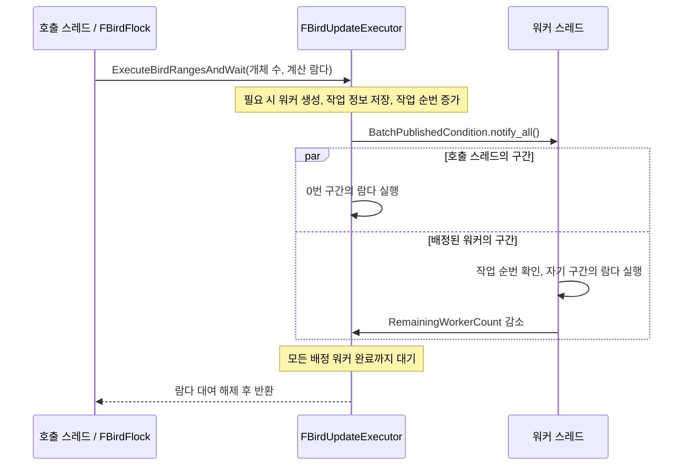

# C++20 코어 개발

연산은 C++20을 Emscripten 4.0.23으로 컴파일한 WASM에서 수행합니다. Three.js 렌더러·UI·Electron 구조를 유지합니다. 클래스와 파일별 책임은 [architecture.md](architecture.md), VS Code 조작은 [vscode.md](vscode.md)를 참조하십시오.

2026-10-29부터 native와 Wasm의 컴파일 표준은 C++20입니다. 기존 JS `backend` 값인
`cpp17-wasm`은 외부 조회 코드의 호환성을 위해 유지한 식별자이며 컴파일 표준을 나타내지
않습니다. 실제 표준은 생성된 `CORE_METADATA.standard`의 `C++20`으로 확인합니다.
과거 리팩토링·성능·배포 검증 문서의 C++17 기록은 당시 조건을 보존합니다.

## 구조

FSimulation은 설정·시간/통계·장애물과 FBirdFlock·FGoal·FPredator를 값으로 소유하며 전체 갱신을 조율합니다. FBirdFlock은 FBirdVectorBuffer 위치/속도 버퍼·난수·진단 vector와 unique_ptr<FNeighborSearch>를 소유합니다. FNeighborSearch는 탐색 선택·생성 시 reserve한 vector 후보와 고정 공간 인덱스의 FKdTree·FSpatialGrid를 소유합니다. FGoal은 목표 위치, FPredator는 현재·이전 위치와 속도를 소유합니다. BoidsApi.cpp에는 C ABI 전달 함수만 있습니다. FSimulation/FBirdFlock/FNeighborSearch의 copy/move를 금지해 ABI 버퍼·속도 역할 포인터·후보 대여의 주소 계약을 유지합니다. FKdTree는 위치를 Rebuild 호출 동안만 읽고 조회에 필요한 분할 좌표를 직접 소유합니다.

설정·상태·장애물 원본 배열과 인덱스 변환은 FSimulationAbi에 둡니다. 계산 코드는 FSimulationConfig와 SimulationState.h/.cpp의 FSimulationState 값을 사용합니다. FSimulationState의 상태는 private이며 GetSnapshot()은 객체 수명에 종속된 const 참조를 제공합니다. FSimulationStateSnapshot은 ABI import와 독립 복사를 위한 값입니다. 각 계산 entry가 외부 입력을 읽고 작업별 출력 State 슬롯만 기록하며 내부 helper는 다시 입력을 읽지 않습니다. 경계 크기는 FWorldBounds, 축은 EAxis로 전달합니다. FObstacleSet은 typed descriptor 스냅샷을 받아 vector<unique_ptr<FObstacle>>로 구/상자 객체를 소유합니다. 같은 형상은 갱신하고 종류 교체·축소는 public virtual 소멸자를 통해 기존 객체를 소멸합니다. FBirdFlock의 모든 함수 구현은 BirdFlock.cpp에 있습니다. 군집 힘의 const 계산은 CalculateFlockingForces, 진단 출력은 PublishBirdInspection이 담당합니다.

수치 계산은 native/src/{core,bodies,spatial,collision,world}/, ABI 변환과 FSimulation의 host-facing 조율은 native/bindings/, 공개 ABI 선언은 native/bindings/include/boids/boids.h에서 수정합니다. JS 입력 검증·장애물 ID/배치 편집은 src/simulation/boids.js 등 서비스에 남아 있습니다. core-bridge.js의 BoidsCoreBridge가 WASM 인스턴스·설정/장애물 포장·이름 있는 슬롯 매핑·typed array 뷰·상태 계측과 속도 역할 연결을 맡습니다. C++의 FSimulationAbi와 JS bridge가 각 언어의 raw ABI 경계를 담당하며 공개 BoidSimulation API는 유지합니다. 화면용 목표 궤도/접선은 goal-path.js에서 계산하며 실제 목표 상태는 Goal.cpp, 포식자는 Predator.cpp에서 갱신합니다.

C++ Core Guidelines와 Unreal Engine 참고 코딩 표준의 적용 범위는 [프로젝트 규칙](cpp-project-rules.md)과 [C++ 코딩 표준](cpp-coding-standard.md)에 명시합니다. 각 class에는 책임과 수명 계약을 한글로 설명합니다.

언리얼 소스 기반 [C++ 코딩 표준](cpp-coding-standard.md)에 따라 일반 class/struct F, 템플릿 T, enum class E 접두, Allman 중괄호와 탭 폭 4의 들여쓰기를 사용합니다. 일반 변수에는 명시적인 타입을 사용합니다. 물리 계수·배열 배치는 SimulationConstants.h에 명명합니다. 계산용 FVector3D(double)와 저장용 FVector3f(실제 float 배열)를 구분하며 개체의 flat float ABI와 기존 반올림 순서는 유지합니다.

## SDK 설치

현재 SDK 위치는 artifacts/emsdk입니다. 개발 시 한 번 설치하며 사용자 PC의 앱 실행에는 필요하지 않습니다.

```powershell
git clone --depth 1 https://github.com/emscripten-core/emsdk.git artifacts/emsdk
.\artifacts\emsdk\emsdk.bat install 4.0.23
.\artifacts\emsdk\emsdk.bat activate 4.0.23
```

다른 SDK 위치는 EMSDK 환경변수로 지정하고 Python은 EMSDK_PYTHON으로 지정합니다. 빌드 스크립트는 SDK 버전을 확인합니다.

## 수정 후 반영

```powershell
npm run build:all
npm test
npm run test:native
npm run test:browser
```

build:core와 네이티브 CMake는 native/sources.txt의 구현 목록을 함께 읽습니다. 새 C++ 구현은 이 파일에 등록합니다. tools/core-sources.mjs는 native/ 아래 모든 .h 헤더를 재귀 수집하며 구현·헤더·목록·CMake·Wasm 빌드 도구를 원본 해시에 포함합니다. 헤더를 별도 수동 목록에 중복 등록하지 않습니다. 생성된 core-binary.js와 core-licenses.txt는 직접 수정하지 않습니다.

일반 npm run build는 이미 생성된 코어를 사용합니다. C++ 원본과 해시가 다르면 중단합니다. VS Code의 기본 빌드 작업은 core 재빌드까지 수행합니다.

```powershell
npm run dev:native
npm run dev:run -- --search grid --count 32 --steps 180 --seed 7
npm run build:exe
npm run test:exe
```

## 네이티브 개체 병렬 갱신

네이티브 CMake 빌드는 `BOIDS_ENABLE_THREADS=ON`이 기본이며 `Threads::Threads`를 연결합니다.
`FBirdFlock`이 소유한 `FBirdUpdateExecutor`는 `std::thread` 워커를 첫 병렬 작업에 생성하고
재사용합니다. 워커 상한은 3개이며 하드웨어 동시성에서 호출 스레드 하나를 제외한 수로 제한합니다.
호출 스레드도 한 구간을 처리하므로 최대 4개 실행 스레드가 참여합니다. 동시성 정보가 없거나
사용 가능한 워커가 없으면 직렬 실행합니다.

화면 하단의 `워커 N개`는 `boids_get_worker_thread_count()`로 코어에서 읽습니다.
최근 완료한 위치 적분·장애물·경계 보정 구간에 실제 참여한 워커 수이며 호출 스레드는 제외합니다.
워커 풀의 전체 크기나 순간 CPU 점유 스레드 수를 뜻하지 않습니다. 작업 전·빈 작업·직렬 실행은
0이며 일시정지 중에는 최근 값을 유지합니다. 현재 웹·Electron EXE는 Wasm이므로
`워커 0개 · 단일 스레드`를 표시합니다. C ABI의 기존 설정·상태 슬롯과 메모리 계약은 유지합니다.

개체 수가 2개 이상이고 워커를 사용할 수 있으면 기본 병렬 실행합니다. 이전의 256개 임계값은
제거했습니다. 개체 0개는 작업 없이 반환하고 1개는 호출 스레드에서 실행합니다. 구간 수는
`min(개체 수, 워커 수 + 1)`이며 이번 작업에 배정되지 않은 워커는 다시 대기합니다.
이 정책은 작은 군집에서도 병렬 동작을 명시적으로 사용하기 위한 것으로, 성능 향상을 측정한 결과는 아닙니다.

병렬 대상은 `CommitVelocitiesAndIntegratePositions`, `ReconcileObstacles`, `ReconcileBounds`의
개체별 반복문입니다. 속도 역할 교체는 작업 배포 전에 한 번만 수행하며, 한 개체 내부의 축·장애물
계산 순서는 유지합니다. 이웃 조회·다음 속도 계산·난수·통계 합산은 기존 직렬 순서를 유지합니다.

각 작업은 겹치지 않는 연속 인덱스 구간만 수정합니다. 설정·장애물은 읽기만 공유하며
`condition_variable`의 조건식과 세대 번호로 작업 전달과 완료 대기를 관리합니다. 함수가 반환할 때
모든 워커의 쓰기가 완료되어 있으므로 이후 보간 복사·통계·ABI 발행과 겹치지 않습니다.
같은 군집에 대한 중첩·동시 명령과 실행 중 외부 ABI 버퍼 쓰기는 지원하지 않습니다.

실행기는 군집의 마지막 멤버로 두어 가장 먼저 소멸합니다. 소멸자는 종료 상태를 설정하고 대기 중인
워커를 깨운 뒤 모두 `join()`하므로 군집 버퍼보다 워커가 먼저 정리됩니다. 작업 콜백과 캡처는 동기
호출 동안만 빌리며 작업별 동적 할당은 하지 않습니다. 콜백은 예외를 던지지 않아야 합니다.

직렬 기준선은 `FBirdFlock(0)`으로 만들 수 있습니다. 전체 네이티브 스레드 경로를 제외하려면
별도 빌드 디렉터리에서 `cmake -S . -B build/native-serial -DBOIDS_ENABLE_THREADS=OFF`로 구성합니다.
`native-parallel-bird-updates` CTest는 구간별 정확히 한 번 실행, 빈 구간 배제, 2·3·32개 개체의
기본 병렬 실행, 실제 작업 스레드 재사용, 워커 상한 0의 명시적 직렬 실행, 서로 다른 실행기의
동시 실행과 종료, 162개 직렬·병렬 군집 시나리오의 전체 ABI 버퍼 일치를 검사합니다.

Wasm은 이 스레드 경로를 컴파일하지 않고 같은 구간 함수를 직렬 실행합니다. ABI v1·고정 2 MiB·
외부 import 없음 계약을 유지하며 웹/Electron에 스레드 생성이나 공유 메모리 요구를 추가하지 않습니다.

### 실행기 이름과 작업 전달

`FBirdFlock`은 개체별 계산을 담은 람다를 만들고 마지막 멤버인 `BirdUpdateExecutor`에
빌려줍니다. 실행기는 계산식이나 군집 버퍼를 소유하지 않으며 구간 분배·작업 통지·완료 대기만 담당합니다.

| 이름 | 책임 |
| --- | --- |
| `ExecuteBirdRangesAndWait` | 람다를 받아 전체 구간이 끝날 때까지 기다리는 공개 진입점 |
| `FBirdUpdateBatch` | 한 호출의 콜백 대여·개체 수·구간 수를 묶은 내부 작업 정보 |
| `FBirdUpdateBatch::ExecuteRange` | 구간 번호를 반열린 인덱스 범위로 변환하고 콜백 실행 |
| `ExecuteBatchAndWait` | 빈 작업·직렬·병렬 선택과 호출 스레드 실행·완료 대기 조율 |
| `PublishBatch` | 잠금 아래 작업 정보 게시·순번 갱신 후 워커 깨우기 |
| `WaitForWorkersAndClearBatch` | 배정 워커 완료 대기 후 공유 작업의 콜백 대여 해제 |
| `RunWorkerLoop` | 새 작업 대기 → 배정 구간 실행 → 완료 보고 반복 |
| `BorrowedRangeTaskObject` / `InvokeRangeTask` | 콜백 객체의 비소유 주소 / 원래 타입으로 복원해 호출하는 함수 |
| `StartWorkerThreadsIfNeeded` | 첫 병렬 호출에서만 워커 풀 생성 |
| `ActiveBatch` | 워커에게 게시된 작업 정보. 워커는 잠금 아래 복사하여 계산 중 사용 |
| `PublishedBatchSequence` | 새 작업을 구별하는 순번 |
| `RemainingWorkerCount` | 아직 끝나지 않은 배정 워커 수. 호출 스레드는 제외 |

공개 호출 형식과 직렬·병렬 선택 정책은 유지합니다. 내부 조율은
`PublishBatch(Batch)` → `Batch.ExecuteRange(0)` → `WaitForWorkersAndClearBatch()` 순서입니다.
호출 스레드와 워커가 같은 `ExecuteRange`를 사용하므로 구간 분할 공식은 한 곳에만 둡니다.

예를 들어 `IntegrateRange`는 `this`, `DeltaTimeSeconds`, `FFlockContext`의 참조를 캡처한
람다 객체입니다. `BorrowedRangeTaskObject`는 이 람다 객체의 주소이며 `FFlockContext`의 주소가 아닙니다.
`InvokeRangeTask`는 캡처가 없는 람다에서 변환된 함수 포인터입니다. 아래의 두 값은 한 쌍으로 동작합니다.

```cpp
const RangeTaskType& OriginalRangeTask = *static_cast<const RangeTaskType*>(BorrowedRangeTaskObject);
OriginalRangeTask(FirstBirdIndex, EndBirdIndexExclusive);
```

캡처가 있는 람다는 일반 함수 포인터로 직접 바꿀 수 없으므로 객체 주소와 호출 함수를 나눕니다.
템플릿 진입점에서 정확한 타입을 알고 호출 함수를 만들고, `.cpp`의 비템플릿 실행기는 타입을
몰라도 이 쌍을 전달할 수 있습니다. `std::function`으로 람다를 복사·소유하지 않고 호출 동안만 빌립니다.



개체 8개와 참여 스레드 4개라면 호출 스레드는 `[0, 2)`, 워커는 각각 `[2, 4)`, `[4, 6)`,
`[6, 8)`을 처리합니다. 구간 끝 인덱스는 포함하지 않습니다. `BatchStateMutex`는 작업 게시·읽기와
완료 수를 보호합니다. 개체 계산 중에는 잠그지 않으며 서로 겹치지 않는 개체 저장소만 수정합니다.

`PublishedBatchSequence`와 각 워커의 `LastObservedBatchSequence`를 비교하므로 통지가 먼저
발생하거나 대기에서 깨어나도 같은 작업을 중복 실행하지 않습니다. `RemainingWorkerCount`가
0이 되면 호출 스레드가 `ActiveBatch`를 초기화하고 반환합니다. 따라서 스택 람다와 캡처한 참조는 작업이
끝날 때까지 살아 있습니다. 소멸자는 종료를 요청하고 워커를 깨운 뒤 `join()`합니다.

## 메모리 계약

- ABI v1의 함수·selector·원소 타입 순서는 유지했습니다. 위치·속도는 float32, 설정·시간·조향 계산은 float64, 이웃 개수/인덱스는 uint16입니다.
- 최대 개체 수는 10,000이며 버퍼 용량 변경은 `boids_abi_schema`에 반영됩니다. 기존 1,200개 용량을 기대하는 어댑터는 새 코어와 혼용할 수 없습니다.
- 내부 C ABI는 입력 검증을 완료한 호출자용입니다. dt는 (0,0.05]초, 활성 개체는 1~10,000개, 장애물은 최대 16개입니다.
- FBirdVectorBuffer는 private std::vector<float>를 생성 시 MaxBirdCount×AxisCount 크기로 초기화하고 복사·이동을 금지합니다. 이웃/inspection vector와 unique_ptr 검색 객체도 생성 시 할당합니다. WASM allocator는 emmalloc이며 초기 2 MiB·메모리 성장 금지를 유지합니다.
- 위치·속도·ABI 진단 저장소는 생성 후 크기/주소를 고정합니다. domain은 const FBirdVectorBuffer&와 BirdIndex/EAxis로 접근하고 GetAbiData만 raw 포인터를 ABI에 대여합니다. CopyFrom은 전체 스냅샷을 기존 저장소에 복사합니다.
- QueryCandidates는 검색 객체 소유 const std::vector<int>&를 반환합니다. const std::vector<int>&로 받아 복사를 피하고 다음 Rebuild/조회가 내용을 바꿀 수 있음을 지킵니다. 후보 scratch는 생성 시 reserve(MaxBirdCount)하며 예약 용량 내 clear/push_back/resize/iota만 수행하여 생산 스텝의 추가 할당을 막는 계약입니다. 하위 Grid/Tree 출력에 용량이 부족하면 할당될 수 있습니다.
- 장애물 소유 vector는 최대 16개를 reserve하고 size가 활성 수입니다. 초기 활성화·형상 종류 교체·축소/재활성화는 객체 할당/해제를 허용합니다. 같은 형상의 위치/크기 갱신과 입력이 그대로인 정상 스텝은 객체를 재사용합니다. ABI 장애물 배열 주소는 형상 객체의 수명과 독립적으로 고정됩니다.
- 모든 개체가 같은 속도 스냅샷을 읽은 뒤 두 버퍼 역할을 교체합니다. 어댑터는 미리 만든 typed array 뷰의 역할을 갱신합니다.
- positions.buffer는 전체 WASM 메모리입니다. byteOffset과 length를 함께 사용해야 정확한 배열에 접근합니다.
- JS search는 탐색 선택용 descriptor입니다. JS query/rebuild를 덮어써도 C++ 탐색에 주입되지 않습니다.
- native C ABI의 단일 객체와 별개로 FSimulation 클래스는 독립 인스턴스를 지원하며 CTest로 격리를 확인합니다.
- renderer는 상태를 읽고 GPU 업로드·표시 보간·궤적·카메라·리소스 해제를 담당합니다.

ABI 진입점과 버퍼 대여 함수는 한글 주석으로 호출자 검증·소유권·수명·속도 역할 재조회를 설명하며 일반 계산 함수와 구분합니다. 내부 이름은 ReadConfigSnapshot/ReadStateSnapshot/ReadObstacleSnapshot/PublishStepState/GetAbiBuffer, IntegrateNextVelocities/CommitVelocitiesAndIntegratePositions/CalculateMetrics처럼 반환과 부수효과를 드러냅니다.

컴파일은 C++20, -O3, -ffp-contract=off, 예외/RTTI 비활성화, MALLOC=emmalloc 설정입니다. C++20 값 반환·std::array/vector/unique_ptr·enum class·필요한 nodiscard를 사용합니다. 외부 함수 import 없이 WASM을 번들에 포함하여 file://, 로컬 서버, boids://에서 사용합니다. Electron은 WASM 컴파일만 허용하는 wasm-unsafe-eval 정책을 사용하며 JavaScript eval과 외부 통신은 허용하지 않습니다.

빌드마다 source hash·실제 imports·주소 안정성·수치 결과를 확인합니다. 검사 실행법과 범위는 [검증 방법](verification.md)에 정리했습니다. 성능 측정은 기능 검사의 통과와 구분합니다.

Boids는 ABI v1·고정 2 MiB·무 import·예외 비활성 계약을 유지합니다. JS는 C API가 대여하는 고정 메모리 뷰를 사용하며, 구체적인 소유권은 [아키텍처](architecture.md)에 정리했습니다.

네이티브 Debug/Release는 MSVC로 같은 소스를 빌드합니다. 브라우저의 WASM과 별도 프로세스이므로 실제 UI 연동은 브라우저/EXE 검사에서 확인해야 합니다. 검증 범위는 [verification.md](verification.md)에 기록합니다.

### C++ 오류 처리 정책

네이티브와 Wasm 모두 C++ 예외를 사용하지 않습니다. CMake의 `boids_core`는 MSVC의
`/EHs-c-`·`_HAS_EXCEPTIONS=0`, GCC/Clang의 `-fno-exceptions`를 소비 타깃에도 전달합니다.
따라서 네이티브 실행기와 CTest도 같은 설정을 사용합니다. Wasm은 기존
`-fno-exceptions` 설정을 유지합니다. [MSVC 옵션의 의미](https://learn.microsoft.com/en-us/cpp/build/reference/eh-exception-handling-model)는 컴파일러 문서를 따릅니다.
`core/BuildPolicy.h`는 예외가 활성화된 내부 C++ 빌드를 거부하며, `check:structure`는
C++의 `try`·`catch`·`throw`와 Windows SEH 구문을 검사합니다.

복구 가능한 입력 오류는 경계에서 검증하고 명시적인 반환값으로 처리합니다. 예를 들어
잘못된 ABI 버퍼 selector는 기존처럼 `nullptr`를 반환합니다. C ABI의 시뮬레이션 명령은
호출자가 검증한 설정을 요구하며, 내부 불변식 위반은 개발 빌드의 assert로 확인합니다.
메모리 할당·스레드 생성 등의 자원 실패는 복구 경로가 없으므로 실행을 계속할 수 없는
오류로 취급합니다. 예외 비활성화가 이런 실패를 성공이나 오류 반환값으로 바꾸지는 않습니다.
정상 반환·소멸 시의 RAII 자원 정리는 유지합니다. JS 입력 검증·개발 도구의 오류 처리는
각 언어의 기존 방식을 사용합니다.

공식 참고: [Emscripten 설치](https://emscripten.org/docs/getting_started/downloads.html), [컴파일 설정](https://emscripten.org/docs/tools_reference/settings_reference.html). 런타임 라이선스는 dist/CORE-LICENSES.txt에 포함합니다.


## Host 스키마 대조

공개 `native/bindings/include/boids/boids.h`에 버퍼 selector·원소 타입·용량·단위·호출 전제·출력 슬롯·대여 수명을 기록합니다. `ECoreBuffer`도 이 헤더의 단일 정의를 사용합니다.

읽기 전용 `boids_abi_schema()`는 C++의 Config/State/selector enum, 원소 크기, 용량, 장애물·inspection offset을 순서대로 FNV-1a word 서명에 반영합니다. `core-bridge.js`는 JS의 같은 이름 있는 스키마로 만든 값과 대조하고 버전 또는 서명이 다르면 TypedArray 대여 전에 오류를 냅니다. 이 서명은 슬롯 연결 실수를 감지하며 보안 인증이나 사용자 입력 검증을 대체하지 않습니다. 슬롯 배치와 수치 API v1은 유지됩니다.

`tests/unit/abi-schema.test.js`에서 실제 재빌드한 Wasm의 일치, 틀린 버전, 누락·변경된 서명의 거부를 검사합니다. C++ 헤더를 수정하면 배포 바이너리·원본 해시를 `npm run build:core`로 함께 갱신합니다.
